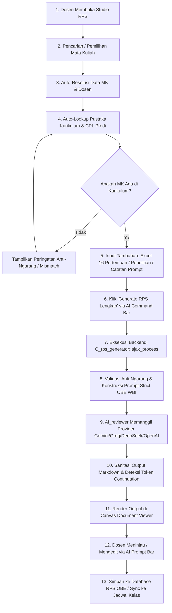

# ANALISIS ARSITEKTUR & PEMETAAN ALUR MODUL PENYUSUNAN RPS (RPS GENERATOR)
**Sistem Informasi Akademik (SIAKAD) Politeknik Wilmar Bisnis Indonesia (WBI)**  
*Dokumen Analisis Komprehensif Implementasi Existing (As-Is)*

---

## 1. Ringkasan Eksekutif & Arsitektur Modul

Modul **RPS Generator Studio** (`C_rps_generator`) merupakan modul penyusunan dokumen pembelajaran komprehensif berbasis luaran (*Outcome-Based Education* / OBE) yang mengacu pada:
1. **Permendiktisaintek No. 39 Tahun 2025** tentang Penjaminan Mutu Pendidikan Tinggi jo. **Permendiktisaintek No. 10 Tahun 2026**.
2. **Pedoman Implementasi SPMI 2026** (Siklus PPEPP: Penetapan, Pelaksanaan, Evaluasi, Pengendalian, Peningkatan).
3. **Standar Penjaminan Mutu Internal (SPMI) Politeknik Wilmar Bisnis Indonesia (WBI)**.
4. **Taksonomi Bloom Terkini**: Penekanan utama pada *Higher Order Thinking Skills* (**HOTS C4 - C6**: Analisis, Evaluasi, Kreasi) tanpa mencantumkan label Bloom pada dokumen publik.

Modul ini tidak hanya menghasilkan dokumen RPS (*Rencana Pembelajaran Semester*) statis, melainkan sebuah **suite dokumen pembelajaran terintegrasi (5-in-1 Single Source of Truth)** yang saling menyelaraskan:
1. **RPS Lengkap 16 Pertemuan** (Formulir SPMI & Matriks Blueprint Asesmen OBE).
2. **Kontrak Pembelajaran** (Formulir SPMI WBI untuk kesepakatan dosen & mahasiswa).
3. **Rancangan Tugas Mahasiswa** (Studi Kasus / *Case Method* / *Project-Based Learning* beserta rubrik penilaian analitik).
4. **Roadmap Pembelajaran Berbasis Modul WBI** (Pemetaan 3–5 modul pembelajaran 16 minggu).
5. **Strategi Pertemuan & Draf Berita Acara Perkuliahan (BAP)** (Langkah operasional SCL per pertemuan 1–16 yang dapat langsung disinkronkan ke jadwal kelas virtual di database).

---

## 2. Identifikasi Komponen Teknis (File Inventory)

### 2.1. View Files (Frontend & UI Canvas)
| Path File | Fungsi & Peran Teknis |
| :--- | :--- |
| [`application/views/rps_generator/v_rps_generator.php`](file:///c:/laragon/www/wbi/server/dosen/application/views/rps_generator/v_rps_generator.php) | **UI Workspace Utama:** Layout 2 panel (*Two-Pane Responsive*). Panel Kiri: Form pencarian MK (Select2), data identitas MK, pemilihan Pustaka Kurikulum & CPL, upload berkas dropzone (Excel 13 kolom, PDF penelitian dosen, draf RPS lama). Panel Kanan (*Sticky Canvas*): Tab navigasi 5 dokumen, area render markdown, in-situ loader, banner interaktif token continuation, dan *AI Command Bar* (chat-stream riwayat prompt). |
| [`application/views/rps_generator/v_rps_generator_after_page.php`](file:///c:/laragon/www/wbi/server/dosen/application/views/rps_generator/v_rps_generator_after_page.php) | **Client-Side Engine:** Mengelola *state storage* (`uploadedDocs`, `modeDocStore`, `modePromptHistory`), inisialisasi AJAX Select2 search MK, event listener upload & parsing file (PDF/Excel/DOCX), rendering markdown via `marked.js`, auto-sanitasi tabel markdown, mekanisme auto-continuation jika token respons AI terpotong, handler *Save to Database* (`ajax_save_to_db`), dan modal sinkronisasi ke jadwal kelas (`modalSyncJadwalKelas`). |
| [`application/views/rps_obe/v_rps_obe_list.php`](file:///c:/laragon/www/wbi/server/dosen/application/views/rps_obe/v_rps_obe_list.php) | **Daftar & Pengelolaan Dokumen RPS:** Tabel DataTables daftar RPS OBE yang telah disusun dosen, status pengajuan (*Draft*, *Diajukan*, *Disetujui*), sasaran CPMK, dan tombol aksi (*RPS View*, *Strategi Pertemuan*, *Studio RPS*, *Delete*). |
| [`application/views/rps_obe/v_rps_obe_list_after_page.php`](file:///c:/laragon/www/wbi/server/dosen/application/views/rps_obe/v_rps_obe_list_after_page.php) | **Script Pengelolaan List RPS:** Handler DataTables server-side, modal preview dokumen, export Excel/Roadmap, dan AJAX delete RPS. |
| [`application/views/setting/setting_api_key_view.php`](file:///c:/laragon/www/wbi/server/dosen/application/views/setting/setting_api_key_view.php) | **UI Konfigurasi API Key AI:** Manajemen kunci API personal dosen untuk Google Gemini, Groq, DeepSeek, dan OpenAI. |

---

### 2.2. Controller Files
| Path File | Fungsi & Endpoint Utama |
| :--- | :--- |
| [`application/controllers/C_rps_generator.php`](file:///c:/laragon/www/wbi/server/dosen/application/controllers/C_rps_generator.php) | **Controller Utama Generator RPS:**<br>• `index()`: Inisialisasi workbench, load pustaka kurikulum, daftar MK diampu.<br>• `ajax_search_mata_kuliah()`: Pencarian MK cepat via AJAX Select2 (min. 3 karakter).<br>• `ajax_upload_doc()`: Parsing file kurikulum/penelitian/RPS lama (PDF, DOCX, TXT) dan auto-indexing ke Pustaka Kurikulum.<br>• `ajax_upload_excel_pertemuan()`: Parsing file spreadsheet Excel 13 kolom WBI.<br>• `ajax_check_pustaka_prodi()` & `ajax_load_pustaka()`: Deteksi otomatis dokumen kurikulum acuan prodi.<br>• `ajax_process()`: **Orkestrator Generasi AI** (validasi anti-ngarang, konstruksi *system prompt* & *user context*, pemanggilan AI, pembersihan hasil markdown, penggabungan Excel).<br>• `ajax_save_to_db()`: Penyimpanan hasil komprehensif ke `siakad_rps_obe` dan `siakad_rps_obe_detail`.<br>• `ajax_check_existing_rps_mk()` & `ajax_load_rps_obe()`: Pengecekan & reload RPS yang pernah tersimpan.<br>• `ajax_get_dosen_schedules()` & `ajax_sync_to_jadwal_kelas()`: Sinkronisasi 16 rencana pertemuan SCL & draf BAP ke `siakad_rencana_pertemuan` pada jadwal perkuliahan dosen.<br>• `export_excel_wbi()` & `export_roadmap_excel()`: Generator unduhan berkas Excel resmi WBI. |
| [`application/controllers/C_rps_obe.php`](file:///c:/laragon/www/wbi/server/dosen/application/controllers/C_rps_obe.php) | **Controller Manajemen Dokumen RPS OBE:** Menangani tampilan list DataTables, pratinjau dokumen (*RPS*, *Kontrak*, *Tugas*, *Roadmap*), cetak PDF, ekspor Excel, dan pengajuan status RPS ke Kaprodi. |
| [`application/controllers/C_strategi_pertemuan.php`](file:///c:/laragon/www/wbi/server/dosen/application/controllers/C_strategi_pertemuan.php) | **Controller Strategi & Realisasi Pertemuan:** Mengelola implementasi rencana 16 pertemuan, realisasi tatap muka, dan pengisian BAP virtual class. |
| [`application/controllers/Setting_api_key.php`](file:///c:/laragon/www/wbi/server/dosen/application/controllers/Setting_api_key.php) | **Controller Pengaturan API Key:** Menyimpan dan menguji konektivitas API Key dosen ke server AI provider. |

---

### 2.3. Service / Library / Helper Files
| Path File | Fungsi & Deskripsi Teknis |
| :--- | :--- |
| [`application/libraries/Ai_reviewer.php`](file:///c:/laragon/www/wbi/server/dosen/application/libraries/Ai_reviewer.php) | **AI Multi-Provider Gateway Service:**<br>• Mendukung 4 provider AI utama: **Google Gemini**, **Groq**, **DeepSeek**, dan **OpenAI**.<br>• Fitur *Self-Healing Auto-Fallback*: Jika model preferensi mengalami *deprecated* / decommissioned (HTTP 404/400), otomatis mencoba model cadangan dalam daftar rantai kandidat.<br>• Fitur *Live API Discovery*: Mengambil daftar model aktif langsung dari endpoint server provider jika seluruh model statis gagal.<br>• Pembersihan token khusus (seperti `<think>` pada model DeepSeek-R1) dan deteksi pemotongan token (*FinishReason: MAX_TOKENS / LENGTH*). |
| `vendor/phpoffice/phpspreadsheet` | **Spreadsheet Engine:** Parsing upload Excel 13 kolom dan pembuatan file unduhan Excel RPS & Roadmap resmi WBI. |
| `vendor/smalot/pdfparser` | **PDF Text Extraction:** Ekstraksi teks dari file PDF kurikulum / RPS acuan yang diunggah. |
| `ZipArchive (PHP Core)` | **DOCX Parser:** Ekstraksi teks murni dari dokumen XML Word (`word/document.xml`). |

---

### 2.4. Model / Repository Files
| Path File | Fungsi & Akses Data |
| :--- | :--- |
| [`application/models/Rps_obe_model.php`](file:///c:/laragon/www/wbi/server/dosen/application/models/Rps_obe_model.php) | Model CRUD utama untuk tabel `siakad_rps_obe` (header dokumen) dan `siakad_rps_obe_detail` (rincian 16 pertemuan), penanganan query DataTables, serta lookup berdasarkan ID atau MD5 hash. |
| [`application/models/Setting_api_key_model.php`](file:///c:/laragon/www/wbi/server/dosen/application/models/Setting_api_key_model.php) | Model pembaca dan penyimpan konfigurasi API Key dosen pada tabel `siakad_api_key`. |

---

### 2.5. Tabel Database Terkait
```mermaid
erDiagram
    sms ||--o{ feeder_mata_kuliah : "memiliki"
    feeder_mata_kuliah ||--o{ siakad_rps_obe : "memiliki RPS"
    siakad_dosen ||--o{ siakad_rps_obe : "dosen pengampu"
    siakad_rps_obe ||--o{ siakad_rps_obe_detail : "memiliki 16 pertemuan"
    siakad_pustaka_kurikulum }o--|| sms : "dokumen kurikulum prodi"
    siakad_jadwal ||--o{ siakad_rencana_pertemuan : "memiliki rencana pertemuan"
    siakad_rps_obe ..> siakad_rencana_pertemuan : "disinkronkan ke"
```

1. **`feeder_mata_kuliah`**: Master mata kuliah (`id_mk`, `kode_mk`, `nm_mk`, `sks_mk`, `sks_tm`, `sks_prak`, `id_sms`).
2. **`feeder_kelas_kuliah`**: Data kelas perkuliahan (`id_kls`, `id_mk`, `id_sms`, `nm_kls`).
3. **`sms`**: Data program studi (`id_sms`, `nm_lemb`).
4. **`siakad_dosen`**: Data dosen pengampu (`id_ptk`, `nm_ptk`, `nidn`).
5. **`kaprodi`**: Data Kaprodi resmi penandatangan RPS (`id_sms`, `id_ptk`, `nama`).
6. **`siakad_pustaka_kurikulum`**: Repositori dokumen Kurikulum & CPL Prodi (`id`, `nama_prodi`, `judul_dokumen`, `file_name`, `file_path_doc`, `file_path_content`, `total_karakter`).
7. **`siakad_api_key`**: Kunci API AI dosen (`id_ptk`, `ai_provider`, `api_key`, `ai_model`).
8. **`siakad_rps_obe`**: Header master RPS OBE & naskah turunan (`id_rps`, `id_ptk`, `id_mk`, `kode_mk`, `nm_mk`, `sks_mk`, `sks_tm`, `sks_prak`, `semester`, `dosen_pengampu`, `cpl`, `tujuan_belajar`, `deskripsi_mata_kuliah`, `prasyarat_mata_kuliah`, `referensi`, `kontrak_kuliah_markdown`, `rancangan_tugas_markdown`, `roadmap_wbi_markdown`, `roadmap_modul_json`, `skenario_pembelajaran_markdown`, `matrix_pertemuan_json`, `raw_ai_output`, `id_status_pengajuan_rps`, `tanggal_rps`).
9. **`siakad_rps_obe_detail`**: Matriks 16 pertemuan RPS (`id_rps`, `kolom_1` s.d. `kolom_13`: minggu, pertemuan, sub-CPMK, bahan kajian, bentuk, metode, pengalaman, jam teori, jam praktek, kriteria evaluasi, indikator evaluasi, bobot, sumber belajar).
10. **`siakad_jadwal` & `siakad_jadwal_detail`**: Jadwal mengajar kelas riil dosen.
11. **`siakad_rencana_pertemuan`**: Rencana 16 tatap muka kelas riil dan draf BAP faktual virtual class yang disinkronkan langsung dari generator.

---

## 3. Pemetaan Alur End-to-End: Pemilihan MK sampai Generate RPS Lengkap

Alur proses penyusunan RPS berlangsung secara terstruktur melalui 10 tahapan berikut:



### Tahap 1: Inisialisasi Studio
- Dosen mengakses route `C_rps_generator`.
- Sistem mengecek otentikasi Ion Auth dan mengambil profil dosen (`id_ptk`, `nm_ptk`).
- Sistem memuat konfigurasi kunci API AI dari `siakad_api_key`.
- Sistem mengambil daftar mata kuliah yang diampu dosen dari `siakad_jadwal` (mengabaikan mata kuliah non-kelas seperti KKN, PKL, Skripsi, MBKM).

### Tahap 2: Pemilihan Mata Kuliah (Select2 Server-Side)
- Dosen mengetik nama atau kode MK pada input Select2 (minimal 3 karakter).
- Endpoint `C_rps_generator/ajax_search_mata_kuliah` mencari ke tabel `feeder_mata_kuliah` digabung dengan data prodi (`sms`) serta menandai apakah MK tersebut sedang diampu oleh dosen login (`diampu_saya`).
- Begitu MK dipilih, fungsi JS `pilihMkObject(item)` otomatis mengisi field: Kode MK, SKS, Semester, Program Studi, dan Dosen Pengampu.

### Tahap 3: Resolusi SKS Teori/Praktek & Kaprodi
- Backend secara otomatis mendeteksi distribusi `sks_tm` dan `sks_prak` dari `feeder_mata_kuliah`.
- Backend mencari nama resmi Ketua Program Studi dari tabel `kaprodi` berdasarkan `id_sms` mata kuliah untuk dicantumkan pada lembar pengesahan RPS dan Kontrak Kuliah.

### Tahap 4: Auto-Lookup Pustaka Kurikulum & CPL (Source-First)
- Fungsi `checkPustakaProdi(prodi)` mengirim AJAX ke `C_rps_generator/ajax_check_pustaka_prodi`.
- Sistem mencari naskah Kurikulum & CPL resmi pada tabel `siakad_pustaka_kurikulum` atau file markdown fisik di `uploads/pustaka_kurikulum/`.
- Naskah kurikulum langsung disiapkan sebagai *Dokumen Acuan Utama (Ground Truth)*.

### Tahap 5: Pengecekan RPS yang Pernah Ada (Existing RPS)
- Fungsi `ajax_check_existing_rps_mk()` memeriksa apakah MK tersebut sudah memiliki dokumen RPS tersimpan di `siakad_rps_obe`.
- Jika sudah ada, sistem memuat naskah yang tersimpan ke dalam *modeDocStore* sehingga dosen dapat langsung melihat, melanjutkan, atau memperbaruinya.

### Tahap 6: Validasi Anti-Ngarang (Strict Anti-Hallucination)
- Sebelum prompt dikirim ke AI, sistem melakukan validasi teks: Apakah Nama MK atau Kode MK benar-benar tercantum dalam naskah Dokumen Kurikulum yang aktif.
- Jika tidak ditemukan sama sekali, sistem menolak eksekusi dan memunculkan notifikasi peringatan (*Kurikulum Mismatch Alert*) untuk mencegah AI mengarang CPL fiktif.

### Tahap 7: Konstruksi System Prompt & User Context (OBE SN-Dikti 2026 WBI)
- Backend menyusun **System Prompt Baku** (*Universal Canonical Style*) yang mengunci:
  1. Taksonomi Bloom level C4 - C6.
  2. Beban CPL proporsional: 5 sampai 7 butir CPL (Sikap, Pengetahuan, KU, KS).
  3. Formula waktu SKS SN-Dikti 2026: 1 SKS = 45 jam / semester = 170 menit/minggu (50 menit TM, 60 menit PT, 60 menit BM).
  4. Blueprint Matriks Asesmen 6 Kolom: Sikap (5-10%), Kuis (5-10%), Tugas (15-20%), Kasus/Proyek (20-25%), UTS (20%), UAS (20-25%) dengan total tepat 100%.
  5. Penolakan terhadap preamble chat ("Tentu, ini draf...") dan penolakan bagian penutup fiktif di luar 16 pertemuan.
- Backend menggabungkan naskah kurikulum, data penelitian dosen, file Excel 16 pertemuan (jika ada), dan catatan prompt instruksi dosen.

### Tahap 8: Pemanggilan AI Multi-Provider (`Ai_reviewer`)
- Modul memanggil `Ai_reviewer->generate_review()`.
- Service mengeksekusi request via cURL ke endpoint provider yang aktif (Google Gemini, Groq, DeepSeek, atau OpenAI).
- Jika respons terpotong karena batas token (*finishReason: MAX_TOKENS / LENGTH*), service menandai `is_truncated = true`.

### Tahap 9: Sanitasi Output Markdown & Penanganan Continuation
- Backend melakukan sanitasi:
  - Memperbaiki rasio waktu TM/Praktek sesuai bobot SKS.
  - Menghapus format bullet/nomor pada item tunggal (seperti Prasyarat "Tidak ada").
  - Menormalkan tabel Markdown agar tidak rusak.
  - Memotong teks halusinasi yang muncul setelah Pertemuan 16.
  - Menyambungkan tabel Bagian 6 dari file Excel dosen jika dosen mengunggah berkas spreadsheet 13 kolom.
- Jika respons terpotong, frontend menampilkan tombol **"Lanjutkan Penyusunan Dokumen"** (`lanjutkanDokumen()`) yang akan memicu prompt kelanjutan (*Continuation Prompt*) mulai dari titik terakhir yang terputus.

### Tahap 10: Multi-Document Generation & Sinkronisasi
- Dari satu Master RPS yang terbentuk, dosen dapat berpindah tab untuk men-generate dokumen turunan:
  1. **Kontrak Kuliah:** Mengadopsi persis CPMK, bobot penilaian, jadwal 16 minggu, dan referensi dari RPS.
  2. **Rancangan Tugas:** Menurunkan tugas studi kasus/proyek dan rubrik analitik dari Sub-CPMK RPS.
  3. **Roadmap Pembelajaran:** Mengelompokkan materi 16 minggu ke dalam 3–5 modul pembelajaran format WBI.
  4. **Strategi Pertemuan:** Merinci sintaks SCL (Pendahuluan, Inti, Penutup) dan draf BAP per pertemuan 1–16.
- Dosen menyimpan seluruh dokumen sekaligus ke database via tombol **"Simpan ke RPS OBE"** (`ajax_save_to_db`).
- Dosen dapat menyinkronkan 16 pertemuan dan draf BAP langsung ke jadwal kelas perkuliahan virtual class via tombol **"Terapkan ke Jadwal & BAP"** (`ajax_sync_to_jadwal_kelas`).

---

## 4. Matriks Data: Data Acuan Database vs Data Hasil AI

Tabel di bawah merinci pemisahan tegas antara data faktual yang diambil dari database/dokumen kurikulum dengan data terstruktur yang dihasilkan/dirumuskan oleh AI:

| Komponen Dokumen | Sumber Data Database / Acuan Faktual | Hasil Formulasi & Generasi AI |
| :--- | :--- | :--- |
| **Identitas Mata Kuliah** | • `feeder_mata_kuliah.nm_mk`<br>• `feeder_mata_kuliah.kode_mk`<br>• `feeder_mata_kuliah.sks_mk`<br>• `feeder_mata_kuliah.sks_tm` & `sks_prak`<br>• `sms.nm_lemb` (Nama Prodi)<br>• `siakad_dosen.nm_ptk` (Dosen Pengampu)<br>• `kaprodi.nm_ptk` (Nama Resmi Kaprodi) | Menata format identitas baku sesuai standar formulir SPMI WBI. |
| **CPL yang Dibebankan** | Naskah resmi Dokumen Kurikulum Prodi dari `siakad_pustaka_kurikulum` (kode CPL Sikap, Pengetahuan, KU, KS). | **Seleksi Proporsional:** Memilih secara ketat 5 sampai 7 butir CPL yang benar-benar relevan dan diukur langsung pada MK ini (mencegah pencampuran CPL dari MK lain). |
| **Capaian Pembelajaran MK (CPMK)** | Diturunkan secara logis dari irisan CPL terpilih dan Bahan Kajian kurikulum prodi. | **Perumusan HOTS:** Merumuskan 3 sampai 5 butir CPMK komprehensif menggunakan kata kerja operasional **Bloom C4 - C6** (Analisis, Evaluasi, Kreasi) tanpa label kode Bloom. |
| **Pemetaan CPMK vs CPL** | Hubungan CPL prodi terhadap mata kuliah. | **Tabel Matriks Pemetaan:** Memetakan setiap butir CPMK terhadap kode-kode CPL yang didukungnya. |
| **Blueprint Asesmen OBE** | Standar penilaian institusi WBI & IKU 7 (Sikap, Kuis, Tugas, Kasus/Proyek, UTS, UAS). | **Distribusi Bobot Asesmen:** Menyusun matriks korelasi Sub-CPMK terhadap 6 instrumen evaluasi dengan total bobot terhadap MK persis 100% dan bobot terhadap CPMK persis 100%. |
| **Deskripsi Mata Kuliah** | Bahan Kajian dan ruang lingkup materi pada dokumen kurikulum prodi. | **Sintesis Narasi:** Menyusun deskripsi komprehensif ruang lingkup keilmuan dan kompetensi yang dibangun dalam 1 paragraf utuh. |
| **Prasyarat Mata Kuliah** | Ketentuan prasyarat eksplisit pada dokumen kurikulum prodi. | **Strict Zero-Hallucination:** Jika tidak tertulis eksplisit di kurikulum, wajib menghasilkan *"Tidak ada"* (dilarang mengarang mata kuliah prasyarat fiktif). |
| **Daftar Referensi / Pustaka** | Input teks prompt khusus dari dosen atau daftar pustaka resmi pada dokumen kurikulum. | **Strict Source-First:** Jika belum ada input referensi, AI memberi penanda wajib input dan menolak mengarang buku/penulis fiktif. |
| **Detail Rencana 16 Pertemuan** | SKS mata kuliah $\rightarrow$ Menghitung alokasi waktu menit TM/Praktek per minggu ($sks \times 50$ menit). Atau data Excel 13 kolom jika diunggah dosen. | **Matriks Pembelajaran 16 Minggu:** Merumuskan Sub-CPMK 1.1–16, pokok materi bahan kajian, bentuk/metode SCL (*Case Method* / PjBL), pengalaman belajar mahasiswa, kriteria & indikator evaluasi, serta sumber belajar. |
| **Kontrak Pembelajaran** | Mengambil 100% data dari Master RPS yang telah dihasilkan. | Menyusun formulir kesepakatan SPMI, tata tertib, hak & kewajiban, skala nilai huruf WBI, dan jadwal perkuliahan 16 minggu. |
| **Rancangan Tugas Mahasiswa** | Sub-CPMK dan topik materi kasus dari Master RPS. | Menyusun panduan penugasan *Case Method* / PjBL: tujuan, obyek garapan, batasan pengerjaan, metode, luaran (*deliverable*), dan rubrik analitik berbobot 100%. |
| **Roadmap Modul WBI** | Bahan kajian 16 pertemuan dari Master RPS. | Mengelompokkan materi ke dalam 3–5 Modul Pembelajaran beserta deliverable output, konsep kunci, indikator, strategi, serta blok data `json_roadmap`. |
| **Strategi Pertemuan & Draf BAP** | 16 Rencana Pertemuan dari Master RPS. | Merinci sintaks SCL 3 tahap (Pendahuluan 15 menit, Inti Kolaborasi 65 menit, Penutup 20 menit) dan draf narasi BAP faktual (Realisasi materi, aktivitas, capaian, kendala, tindak lanjut). |

---

## 5. Analisis Kritis & Temuan Implementasi Saat Ini

Berdasarkan penelusuran menyeluruh terhadap basis kode (*codebase review*), ditemukan sejumlah keunggulan arsitektural serta area yang perlu diperhatikan:

### Keunggulan Arsitektural (Strengths):
1. **Penerapan Prinsip Anti-Halusinasi (Zero-Hallucination):** Terdapat validasi berlapis pada backend (`_get_kurikulum_content` dan validasi keberadaan nama/kode MK di naskah kurikulum) sebelum AI dijalankan.
2. **Kepatuhan Regulasi Nasional & Institusi:** Penyelarasan penuh terhadap Permendiktisaintek 39/2025 jo. 10/2026, SPMI 2026, serta standar formulir SPMI Politeknik WBI.
3. **Resiliensi Multi-Provider AI:** Dukungan fallback cerdas pada `Ai_reviewer` yang dapat beralih otomatis jika model Gemini/Groq/DeepSeek/OpenAI mengalami perubahan versi API (*Auto-Discovery & Auto-Heal*).
4. **Konektivitas Langsung ke Virtual Class:** Fitur `ajax_sync_to_jadwal_kelas` memungkinkan hasil luaran AI langsung diterapkan ke data jadwal mengajar nyata (`siakad_rencana_pertemuan`), sehingga dosen tidak perlu menyalin manual 16 pertemuan perkuliahan.
5. **Dukungan Hibrida (Spreadsheet + AI):** Dosen dapat mengunggah matriks 16 pertemuan yang sudah ada dalam format Excel 13 kolom WBI, lalu AI hanya menyusun bagian pendahuluan, CPL, CPMK, dan Blueprint Asesmen.

### Catatan Kritis & Rekomendasi (Opportunities for Enhancement):
1. **Penanganan Token Output pada Dokumen Sangat Panjang:** Meskipun sudah ada fitur *Continuation Banner*, generasi 16 pertemuan lengkap sekaligus tetap mengonsumsi token yang besar. Model chunking bertahap per modul/bagian dapat dipertimbangkan untuk koneksi internet lambat.
2. **Sinkronisasi Kode MK Antar Tabel:** Penelusuran data prodi menggunakan fallback multi-tabel (`feeder_mata_kuliah`, `feeder_kelas_kuliah`, `sms`). Struktur relasi prodi pada RPS sudah dibuat kokoh melalui helper `_resolve_prodi_for_rps()`.
3. **Pustaka Kurikulum Terpusat:** Dokumen kurikulum prodi saat ini tersimpan dalam bentuk file teks/markdown di `uploads/pustaka_kurikulum/` yang diindeks ke `siakad_pustaka_kurikulum`. Pengelolaan kurikulum terpusat pada menu `C_kurikulum` sangat krusial untuk memastikan seluruh dosen menggunakan dokumen acuan versi terbaru.

---
*Dokumen laporan ini disusun secara otomatis berdasarkan analisis kode sumber aktual di direktori `c:/laragon/www/wbi/server/dosen/` per 17 September 2026.*
