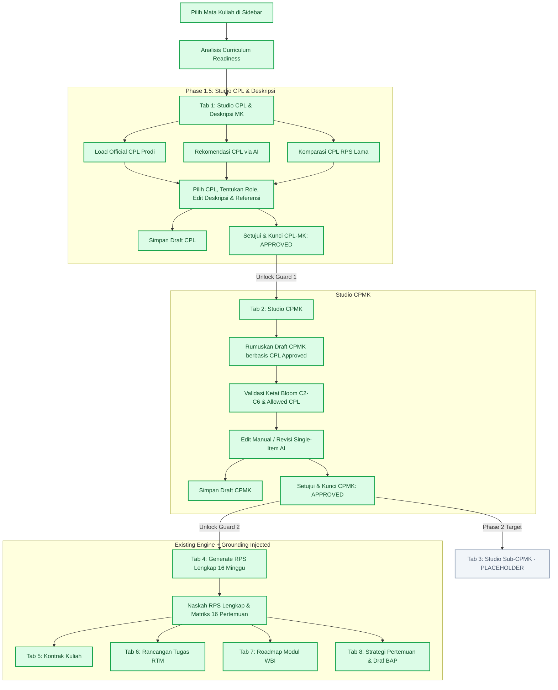

# LAPORAN IMPLEMENTASI TERKINI RPS GENERATOR AI
**Modul:** RPS Generator AI OBE & SN-Dikti 2026 (WBI)  
**Dokumen:** `docs/RPS_IMPLEMENTATION_CURRENT_STATE.md`  
**Waktu Audit:** 17 September 2026  
**Cakupan Audit:** Phase 1 (Grounding & Parser), Final Consistency Patch, Phase 1.5 (Studio CPL & Deskripsi MK, Komparasi RPS Lama, Guard Approval)

---

## 1. EXECUTIVE SUMMARY

Modul RPS Generator AI saat ini telah menyelesaikan **Phase 1 (Grounding & Parser)** dan **Phase 1.5 (Studio CPL & Deskripsi Mata Kuliah Interaktif)**. Sistem telah bertransisi dari generator satu-kali-klik (monolitik) menjadi workflow modular bertahap (*stage-by-stage guided OBE workflow*) yang menjamin keterlacakan (*provenance*) dan keselarasan kurikulum resmi program studi.

### Ringkasan Status Fitur:
* **Fase Implementasi Saat Ini**: **Phase 1.5 Complete** (Siap menuju Phase 2: Sub-CPMK Studio).
* **Fitur Utama yang Selesai**:
  1. **Dokumen Kurikulum RAG & Grounding Engine**: Parser CPL resmi prodi dengan pemetaan multi-tier (Matrix I/Peta Kurikulum, Deskripsi MK, Bahan Kajian).
  2. **Curriculum Readiness Inspector**: Real-time audit kesiapan 7 parameter kurikulum (Dokumen, MK, CPL, Mapping, BK, Deskripsi, CPMK).
  3. **Studio CPL & Deskripsi MK (Tab 1)**:
     - Ekstraksi seluruh CPL resmi prodi (S, P, KU, KK).
     - Rekomendasi AI CPL dinamis (3–6 butir terpenting).
     - **Pembanding CPL dari Arsip RPS Lama (`siakad_rps_online`)** dengan deteksi relevansi otomatis (Notifikasi Hijau jika selaras, Notifikasi Kuning/Merah jika standar lama/kosong).
     - Penentuan peran CPL-MK (*Primary / Supporting*).
     - Sanitasi otomatis HTML & penomoran referensi buku (*1., 2., dst per baris baru*).
     - Workflow Simpan Draft, Setujui/Kunci (`APPROVED`), dan Buka Kunci (`Revisi`).
  4. **Studio CPMK (Tab 2)**:
     - Perumusan CPMK berbasis hanya pada CPL-MK yang telah `APPROVED`.
     - Validasi ketat Taksonomi Bloom (C2–C6).
     - Edit inline manual, tambah/hapus butir, dan revisi AI per butir (*single-item prompt*).
     - Workflow Approval CPMK (`APPROVED` lock).
  5. **Guard & Stepper Workflow**: Penguncian bertingkat (Studio CPMK terkunci sebelum CPL `APPROVED`; Generate RPS Lengkap & Dokumen Turunan terkunci sebelum CPMK `APPROVED`).
* **Fitur Placeholder / Belum Dikerjakan**:
  - **Studio Sub-CPMK (Tab 3)**: Masih berstatus *Disabled Placeholder* untuk target implementasi **Phase 2**.
* **Guard Approval RPS Lengkap**:
  - Frontend: Tombol Generate RPS Lengkap terkunci jika status CPMK belum `APPROVED`.
  - Backend: Method `ajax_process` menolak eksekusi mode `susun_rps`, `kontrak_kuliah`, `rancangan_tugas`, `roadmap_wbi`, dan `skenario_pembelajaran` jika `cpmk_status !== 'APPROVED'`.

---

## 2. FILE YANG TERKAIT

| File Path | Fungsi Utama | Perubahan Utama yang Sudah Dilakukan |
| :--- | :--- | :--- |
| `application/controllers/C_rps_generator.php` | Controller utama modul RPS Generator & API Endpoint | Implementasi parser kurikulum (`_extract_official_curriculum_cpl`), grounding analysis (`_analyze_curriculum_grounding`), endpoints Studio CPL (`ajax_get_cpl_studio`, `ajax_save_cpl_studio`, `ajax_approve_cpl_studio`, `ajax_revise_cpl_studio`, `ajax_get_cpl_rps_lama`), CPMK validator (`_parse_and_validate_cpmk_json`), pembersih teks HTML (`_clean_html_to_plain_text`, `_clean_deskripsi_text`, `_clean_referensi_text`), dan workflow guards di `ajax_process`. |
| `application/models/Rps_obe_model.php` | Model database CRUD untuk `siakad_rps_obe` | Penanganan relasi CRUD dan abstraksi penyimpanan dokumen RPS OBE. |
| `application/models/Setting_api_key_model.php` | Model konfigurasi AI Key | Manajemen multi-provider AI (Gemini, OpenAI, Groq, Anthropic, DeepSeek). |
| `application/libraries/Ai_reviewer.php` | Library HTTP Client & Multi-Provider AI LLM | Penanganan streaming, JSON parser, retry handling, dan system-prompt injection. |
| `application/views/rps_generator/v_rps_generator.php` | View markup utama, layout canvas, & modal dialog | Implementasi Tab Navigation 8 tahap, stepper status OBE, layout Studio CPL & Deskripsi, Studio CPMK card editor, modal komparasi CPL RPS Lama (`modal_cpl_rps_lama`), dan modal pencarian arsip lama (`modal_ambil_rps_lama`). |
| `application/views/rps_generator/v_rps_generator_after_page.php` | Client-side scripting & UI state management | Logika interaktif Studio CPL (filter, role toggles, AI recommendation, sanitasi teks realtime, locking), komparasi 2-kolom CPL RPS Lama, Studio CPMK renderer, Bloom validator guard, modal handlers, dan export handlers. |
| `docs/struktur_tabel_rps_obe_2026.md` | Dokumentasi arsitektur database | Spesifikasi skema tabel `siakad_rps_obe`, `siakad_rps_obe_detail`, `siakad_pustaka_kurikulum`, dan `siakad_api_key`. |

---

## 3. DATABASE / SCHEMA CURRENT STATE

### Tabel Utama: `siakad_rps_obe`

| Kolom | Tipe Data | Nullable / Default | Fungsi & Deskripsi | Kapan Diisi | Source of Truth |
| :--- | :--- | :--- | :--- | :--- | :--- |
| `id_rps` | `int unsigned` | `NO` (PK, AI) | Primary Key data RPS OBE | Saat pembuatan RPS pertama kali | Database Server |
| `id_ptk` | `varchar(50)` | `NO` | ID PTK / NIDN Dosen pengampu penyusun | Inisialisasi awal | Session Auth |
| `kode_mk` | `varchar(30)` | `NO` | Kode resmi mata kuliah | Pemilihan MK di sidebar | Feeder MK / Kurikulum |
| `nm_mk` | `varchar(255)` | `NO` | Nama resmi mata kuliah | Pemilihan MK di sidebar | Feeder MK / Kurikulum |
| `sks_mk` | `int` | `YES` (Default 3) | Bobot total SKS | Pemilihan MK | Feeder MK / Kurikulum |
| `deskripsi_mata_kuliah` | `text` | `YES` | Narasi ringkas deskripsi mata kuliah | Studio CPL (Save / Approve) | Dosen / Kurikulum / RPS Lama |
| `deskripsi_mk_source` | `varchar(30)` | `YES` | Provenance sumber deskripsi (`CURRICULUM`, `RPS_LAMA`, `AI_DRAFT`, `MANUAL`) | Studio CPL | Dosen / Sistem |
| `referensi` | `text` | `YES` | Daftar buku teks rujukan perkuliahan (Wajib) | Studio CPL | Dosen / RPS Lama / Kurikulum |
| `cpl_mk_json` | `longtext` | `YES` | Array JSON terstruktur butir CPL terpilih beserta peran (*PRIMARY/SUPPORTING*) dan provenance | Studio CPL (Save / Approve) | Dosen (Approved) |
| `cpl_mk_status` | `varchar(20)` | `YES` | Status persetujuan CPL-MK (`DRAFT`, `APPROVED`) | Studio CPL | Dosen |
| `cpmk_json` | `longtext` | `YES` | Array JSON butir CPMK (kode, narasi, level Bloom, cpl_code, provenance) | Studio CPMK (Save / Approve) | Dosen (Approved) |
| `cpmk_status` | `varchar(20)` | `YES` | Status persetujuan CPMK (`AI_PROPOSAL`, `DRAFT`, `APPROVED`) | Studio CPMK | Dosen |
| `raw_ai_output` | `longtext` | `YES` | Naskah lengkap Markdown RPS 16 Pertemuan | Generate RPS Lengkap | AI OBE Engine |
| `matrix_pertemuan_json` | `longtext` | `YES` | JSON matriks detail 16 minggu pertemuan | Generate RPS / Simpan DB | AI OBE Engine / Excel |
| `kontrak_kuliah_markdown` | `longtext` | `YES` | Naskah Markdown Kontrak Perkuliahan | Generate Kontrak Kuliah | AI Engine |
| `rancangan_tugas_markdown` | `longtext` | `YES` | Naskah Markdown RTM (Case / Project) | Generate Rancangan Tugas | AI Engine |
| `roadmap_wbi_markdown` | `longtext` | `YES` | Naskah Markdown Roadmap Pembelajaran WBI | Generate Roadmap | AI Engine |
| `skenario_pembelajaran_markdown` | `longtext` | `YES` | Naskah Skenario Pembelajaran SCL & Draf BAP | Generate Skenario BAP | AI Engine |

### Status Migrasi Database:
Semua kolom di atas telah terpasang dan tervalidasi pada database lokal maupun database server (`portal_wbi_server`).

---

## 4. WORKFLOW AKTUAL END-TO-END



### Evaluasi Tahapan Terhadap Desain:
1. **Pilih MK & Curriculum Readiness**: `IMPLEMENTED`
2. **Studio CPL & Deskripsi MK**: `IMPLEMENTED`
3. **Approve CPL-MK & Deskripsi**: `IMPLEMENTED`
4. **Studio CPMK**: `IMPLEMENTED`
5. **Approve CPMK**: `IMPLEMENTED`
6. **Studio Sub-CPMK**: `PLACEHOLDER` (Dijadwalkan untuk Phase 2)
7. **Generate RPS Lengkap**: `IMPLEMENTED` (Diproteksi oleh CPMK Approval Guard)
8. **Dokumen Turunan (Kontrak, Tugas, Roadmap, BAP)**: `IMPLEMENTED`

---

## 5. TAB / UI CURRENT STATE

Urutan dan status 8 Tab navigasi pada canvas RPS Generator:

| No | Nama Tab | Mode Identifier | Status Implementasi | Default Active | Kondisi Lock / Guard | Sumber Data Utama | Tombol Utama | Endpoint AJAX | Read-only Mode |
| :--- | :--- | :--- | :--- | :--- | :--- | :--- | :--- | :--- | :--- |
| 1 | **Deskripsi dan CPL** | `studio_cpl` | `IMPLEMENTED` | **Ya** (Default saat MK dipilih) | Terbuka bebas | Dokumen Kurikulum / `siakad_rps_online` / `siakad_rps_obe` | *Rekomendasi AI*, *RPS Lama*, *Ambil dari Kurikulum*, *Simpan Draft*, *Setujui & Kunci*, *Revisi* | `ajax_get_cpl_studio`, `ajax_generate_cpl_recommendation`, `ajax_get_cpl_rps_lama`, `ajax_save_cpl_studio`, `ajax_approve_cpl_studio`, `ajax_revise_cpl_studio` | Ya (Input dikunci, tombol aksi disembunyikan saat `APPROVED`) |
| 2 | **CPMK** | `susun_cpmk` | `IMPLEMENTED` | Tidak | **Terkunci** jika CPL-MK belum `APPROVED` | CPL-MK Approved + Bloom C2–C6 Engine | *Susun Draft CPMK*, *Tambah CPMK*, *Revisi AI (Item)*, *Simpan Draft*, *Setujui CPMK*, *Revisi CPMK* | `ajax_process (mode: susun_cpmk)`, `ajax_save_cpmk` | Ya (Card dikunci ke mode review saat `APPROVED`) |
| 3 | **sub-cpmk** | `susun_subcpmk` | `PLACEHOLDER` | Tidak | **Terkunci Permanen (Disabled)** | - | Placeholder Phase 2 | - | - |
| 4 | **RPS** | `susun_rps` | `IMPLEMENTED` | Tidak | **Terkunci** jika CPMK belum `APPROVED` | CPMK Approved + Matriks 16 Pertemuan | *Susun RPS*, *Perbarui*, *Simpan ke RPS OBE*, *Unduh .md*, *Cetak* | `ajax_process (mode: susun_rps)`, `ajax_save_to_db` | Tidak (Dapat regenerasi ulang) |
| 5 | **kontrak kuliah** | `kontrak_kuliah` | `IMPLEMENTED` | Tidak | **Terkunci** jika CPMK belum `APPROVED` | Dokumen RPS Induk + Kurikulum | *Susun Kontrak*, *Simpan ke DB* | `ajax_process (mode: kontrak_kuliah)` | Tidak |
| 6 | **rancangan tugas** | `rancangan_tugas` | `IMPLEMENTED` | Tidak | **Terkunci** jika CPMK belum `APPROVED` | Dokumen RPS Induk (Case/Project) | *Susun RTM*, *Simpan ke DB* | `ajax_process (mode: rancangan_tugas)` | Tidak |
| 7 | **roadmap** | `roadmap_wbi` | `IMPLEMENTED` | Tidak | **Terkunci** jika CPMK belum `APPROVED` | Dokumen RPS Induk + Modul WBI | *Susun Roadmap*, *Unduh .xlsx* | `ajax_process (mode: roadmap_wbi)`, `export_roadmap_excel` | Tidak |
| 8 | **Strategi Pertemuan** | `skenario_pembelajaran` | `IMPLEMENTED` | Tidak | **Terkunci** jika CPMK belum `APPROVED` | Matriks RPS 16 Pertemuan | *Susun Skenario*, *Terapkan ke Jadwal & BAP* | `ajax_process (mode: skenario_pembelajaran)`, `ajax_sync_to_jadwal_kelas` | Tidak |

---

## 6. CURRICULUM READINESS

Modul `ajax_check_curriculum_readiness` melakukan audit real-time terhadap 7 parameter kesiapan:

1. **Dokumen Kurikulum**: Memeriksa ketersediaan dokumen kurikulum prodi di `siakad_pustaka_kurikulum`.
2. **Mata Kuliah di Kurikulum**: Memeriksa apakah nama/kode MK tercantum di dalam teks kurikulum.
3. **CPL Prodi**: Memeriksa keberadaan butir CPL resmi prodi (S, P, KU, KK).
4. **Pemetaan CPL ↔ MK**: Menentukan derajat keterikatan pemetaan CPL pada mata kuliah.
5. **Bahan Kajian**: Mendeteksi materi / Body of Knowledge terkait MK.
6. **Deskripsi MK**: Mendeteksi ada tidaknya paragraf deskripsi MK di kurikulum.
7. **Status CPMK**: Memeriksa status CPMK tersimpan (`APPROVED` / `DRAFT` / `BELUM ADA`).

### Status Pemetaan (`mapping_source_status`) & Fallback:
* `MATRIX_PARSED`: Tabel Matriks Kurikulum (Matriks I / Peta Kurikulum) berhasil diparsing secara deterministik.
* `MATRIX_UNPARSED`: Tabel matriks ditemukan dalam dokumen namun tidak dapat diparsing kolomnya (misal dokumen PDF hasil scan/layout kompleks).
* `SECTION_PARSED`: Pemetaan ditemukan pada bagian bab uraian mata kuliah.
* `SECTION_UNPARSED`: Bagian bab uraian mata kuliah tidak mencantumkan kode CPL eksplisit.
* `NO_EXPLICIT_SOURCE`: Dokumen kurikulum tidak memiliki tabel matriks CPL↔MK sama sekali.

### Derajat Tipe Pemetaan (`effective_mapping_type`):
* `EXPLICIT_MATRIX`: Kode CPL diambil langsung dari perpotongan baris/kolom matriks kurikulum.
* `EXPLICIT_SECTION`: Kode CPL diambil dari daftar CPL pada uraian ringkas mata kuliah.
* `DERIVED_VIA_BK`: Kode CPL diturunkan melalui irisan Bahan Kajian (BK).
* `AI_EXTRACTED_MAPPING`: AI mengekstrak pemetaan berdasarkan analisis teks kurikulum resmi.
* `AI_PROPOSAL_MAPPING`: Fallback di mana AI mengusulkan 3–6 butir CPL resmi yang relevan karena dokumen kurikulum tidak memetakan MK tersebut secara eksplisit.
* `NOT_AVAILABLE`: Kurikulum tidak ditemukan.

---

## 7. CPL EXTRACTION & GROUNDING

* **Parser Function**: `C_rps_generator::_extract_official_curriculum_cpl($content)`
* **Section Boundary**:
  - *Start Patterns*: `Standar Kompetensi Lulusan (SKL/CPL)`, `Capaian Pembelajaran Lulusan`, `CAPAIAN PEMBELAJARAN LULUSAN PROGRAM STUDI`.
  - *Stop Patterns*: `Bahan Kajian`, `Penetapan Bahan Kajian`, `Matriks I`, `Peta Kurikulum`, `Distribusi Mata Kuliah`.
* **Supported Prefixes**:
  - `S` (Sikap, S-1 s.d S-11)
  - `P` (Pengetahuan, P-1 s.d P-28)
  - `KU` / `U` (Keterampilan Umum, KU-1 s.d KU-13)
  - `KK` / `KS` (Keterampilan Khusus, KK-1 s.d KK-20)
* **Pencegahan Pseudo-Label & Halusinasi**:
  Setiap butir CPL dimasukkan ke dalam `allowed_lookup` map. AI diberikan instruksi mutlak (*negative constraint*) bahwa kode CPL di luar `allowed_lookup` akan langsung direject oleh validator regex.

### Hasil Ekstraksi Aktual pada Database:
* **TRPL (Teknologi Rekayasa Perangkat Lunak)**: Berhasil mengekstrak 29 butir CPL resmi.
* **AP (Akuntansi Perpajakan)**: Berhasil mengekstrak 31 butir CPL resmi.
* **PKA (Pengelolaan Konvensi dan Acara)**: Berhasil mengekstrak 33 butir CPL resmi.
* **MPI (Manajemen Pemasaran Internasional)**: Berhasil mengekstrak 30 butir CPL resmi.
* **AH (Agribisnis Hortikultura)**: Berhasil mengekstrak 28 butir CPL resmi.

---

## 8. STUDIO CPL & DESKRIPSI MK (PHASE 1.5)

### Fitur yang Telah Terimplementasi Penuh:
* [x] **Load Official CPL**: Menampilkan seluruh butir CPL prodi secara terkelompok dengan badge kategori.
* [x] **AI Recommendation**: Rekomendasi 3–6 butir CPL esensial berdasarkan deskripsi dan bahan kajian.
* [x] **Komparasi & Pilihan CPL RPS Lama**: Menghubungkan arsip `siakad_rps_online`, membandingkan teks CPL lama (*Sikap, Pengetahuan, KU, KK*) dengan CPL 2026, menghitung skor overlap kata kunci, serta menyajikan notifikasi relevansi otomatis (*Hijau jika selaras, Kuning/Merah jika format lama*).
* [x] **Checkbox & Role Switcher**: Dosen bebas memilih/membatalkan butir CPL dan menentukan peran (*★ Utama / 🛡 Pendukung*).
* [x] **Draft Deskripsi AI & Pengambilan Sumber**: Opsi mengambil deskripsi dari Kurikulum, dari RPS Lama, atau menyusun draft AI baru.
* [x] **Sanitasi HTML Otomatis**: Menghilangkan seluruh tag HTML dan tag Office XML dari deskripsi dan referensi.
* [x] **Formatting Referensi Realtime**: Memformat daftar pustaka bernomor (*1., 2., dst*) otomatis terpisah per baris baru (`\n`) tanpa merusak format edisi buku.
* [x] **Approval & Revisi Workflow**:
  - Tombol **"Setujui & Kunci CPL-MK Ini"** -> status menjadi `APPROVED`, form menjadi read-only, tombol AI & RPS Lama disembunyikan/di-lock, dan membuka gembok Studio CPMK.
  - Tombol **"Revisi CPL & Deskripsi"** -> status kembali ke `DRAFT`, form kembali editable, dan tombol aksi aktif kembali.

### Struktur Data `cpl_mk_json` pada Database:
```json
[
  {
    "code": "KK-1",
    "category": "KK",
    "description": "Mampu melakukan tugas administrasi event yang meliputi perencanaan dan pengelolaan keuangan...",
    "role": "PRIMARY",
    "source": "RPS_LAMA_ADOPTED",
    "provenance": "RPS_LAMA_ADOPTED",
    "approved": true
  },
  {
    "code": "S-9",
    "category": "S",
    "description": "Menunjukkan sikap bertanggungjawab atas pekerjaan di bidang keahliannya secara mandiri",
    "role": "SUPPORTING",
    "source": "AI_RECOMMENDATION",
    "provenance": "AI_RECOMMENDATION",
    "approved": true
  }
]
```

---

## 9. CPMK STUDIO

* **Generation Flow**: Mengirimkan hanya daftar CPL-MK yang telah `APPROVED` beserta Deskripsi MK ke AI LLM.
* **Allowed CPL Codes Validation**: Setiap butir CPMK yang dirumuskan wajib merujuk secara valid ke kode CPL yang telah disetujui. CPMK dengan rujukan CPL fiktif akan otomatis ditolak.
* **Bloom C2–C6 Strict Validation**: Kata kerja operasional (KKO) dianalisis menggunakan kamus Taksonomi Bloom. Level C1 (Mengingat) otomatis direject atau di-upgrade ke C2/C3 sesuai konteks pendidikan tinggi vokasi.
* **Interaktivitas**:
  - Edit inline narasi CPMK & ubah dropdown level Bloom (C2–C6).
  - Tambah butir baru / hapus butir CPMK.
  - Revisi AI per butir (*Single-item inline revision*).
  - Simpan Draft (`cpmk_status = 'AI_PROPOSAL' / 'DRAFT'`).
  - Setujui CPMK (`cpmk_status = 'APPROVED'`).

### Struktur Data `cpmk_json` pada Database:
```json
[
  {
    "code": "CPMK-1",
    "cpl_code": "KK-1",
    "bloom_level": "C3",
    "statement": "Mampu merancang alur administrasi dan pengelolaan keuangan event sesuai SOP industri.",
    "provenance": "APPROVED"
  },
  {
    "code": "CPMK-2",
    "cpl_code": "S-9",
    "bloom_level": "C2",
    "statement": "Mampu menunjukkan komitmen integritas dan tanggung jawab mandiri dalam penugasan event korporasi.",
    "provenance": "APPROVED"
  }
]
```

---

## 10. BLOOM VALIDATION

* **Kamus KKO Bloom**:
  - `C2 (Memahami)`: Menjelaskan, menguraikan, mengidentifikasi, mengkategorikan, menerangkan, mendiskusikan.
  - `C3 (Menerapkan)`: Menerapkan, mengimplementasikan, menggunakan, menghitung, menyusun, mempraktikkan.
  - `C4 (Menganalisis)`: Menganalisis, membandingkan, mendiagnosis, menguji, membedakan, menelaah.
  - `C5 (Mengevaluasi)`: Mengevaluasi, menilai, mereview, mengkritik, memvalidasi, memutuskan.
  - `C6 (Menciptakan)`: Merancang, mendesain, memformulasikan, membangun, memproduksi, mengonstruksi.
* **Behavior Penanganan KKO Rendah (C1)**:
  Sistem melarang KKO level C1 (*menghafal, menyebutkan*) untuk CPMK Pendidikan Tinggi. AI secara sistematis dipandu menggunakan prompt instruksi tegas untuk hanya menghasilkan perumusan pada rentang C2–C6.
* **Validator Multi-Item**: Method `_parse_and_validate_cpmk_json` memeriksa setiap butir secara independen. Jika terdapat butir yang memiliki kode CPL di luar daftar approved, butir tersebut ditolak secara individual.

---

## 11. GENERATE RPS LENGKAP & DOKUMEN TURUNAN

* **Frontend Lock**:
  Tab *RPS (susun_rps)*, *Kontrak Kuliah*, *Rancangan Tugas*, *Roadmap*, dan *Strategi Pertemuan* menampilkan status terkunci jika `activeCpmkStatus !== 'APPROVED'`.
* **Backend Guard (`C_rps_generator::ajax_process`)**:
  ```php
  $rps_generation_modes = ['susun_rps', 'kontrak_kuliah', 'rancangan_tugas', 'roadmap_wbi', 'skenario_pembelajaran'];
  if (in_array($mode, $rps_generation_modes) && !empty($mata_kuliah)) {
      // Validasi cpmk_status == 'APPROVED' dari database siakad_rps_obe
      if ($cpmk_status_check !== 'APPROVED') {
          echo json_encode([
              'status' => false,
              'msg'    => 'Penyusunan RPS Lengkap dan Dokumen Pembelajaran mewajibkan CPMK berstatus APPROVED di Studio CPMK.'
          ]);
          return;
      }
  }
  ```
* **Status Requirement Saat Ini**:
  Hanya mewajibkan **CPMK berstatus APPROVED**. Sub-CPMK belum menjadi syarat pemblokiran karena Sub-CPMK Studio merupakan target Phase 2.

---

## 12. EXISTING RPS GENERATOR ENGINE

* **16 Pertemuan Matriks**: Tetap di-generate menggunakan prompt komprehensif WBI standar 16 minggu (Minggu 8 UTS, Minggu 16 UAS) yang kini telah diinjeksi (*grounded*) dengan butir CPMK approved dan referensi wajib.
* **siakad_rps_obe_detail**: Menyimpan rincian tiap pertemuan (minggu_ke, sub_cpmk, bahan_kajian, bentuk_pembelajaran, kriteria_penilaian, bobot_nilai).
* **Dokumen Turunan**:
  - *Kontrak Kuliah*: Menyelaraskan komponen penilaian dengan RPS Induk.
  - *Rancangan Tugas (RTM)*: Berfokus pada Case Method / Team-Based Project.
  - *Roadmap Modul WBI*: Format naskah modul pembelajaran mingguan.
  - *Strategi Pertemuan & Draf BAP*: Terintegrasi dengan fitur sinkronisasi langsung ke jadwal perkuliahan kelas (`ajax_sync_to_jadwal_kelas`).
* **Integrasi AI**: Engine existing tidak dirombak secara destruktif, melainkan diperkuat dengan *Prompt Injections* yang mengambil data faktual dari Studio CPL dan Studio CPMK.

---

## 13. BACKWARD COMPATIBILITY

* **RPS Lama Tanpa `cpl_mk_json`**:
  Jika data RPS lama di-load (`ajax_load_rps_obe`), sistem mengecek kolom `cpl_mk_json`. Jika kosong, sistem melakukan fallback mengambil CPL dari mapping kurikulum dan menetapkan status `DRAFT`. Data lama tetap terbuka normal tanpa error.
* **RPS Lama Tanpa `cpmk_json`**:
  Sistem membaca kolom teks legacy `tujuan_belajar` atau `cp_mata_kuliah` dan memparsingnya menjadi draf CPMK berstatus `AI_PROPOSAL` / `DRAFT`.
* **Old RPS Approval Flag**:
  Sistem **TIDAK** menganggap RPS lama otomatis `APPROVED` secara membabi buta. Dosen diarahkan untuk melakukan review dan menekan tombol *Setujui & Kunci* pada Studio CPL dan Studio CPMK agar selaras dengan standar OBE 2026.
* **Data Naskah & Dokumen Turunan Existing**:
  Seluruh kolom teks `raw_ai_output`, `kontrak_kuliah_markdown`, `rancangan_tugas_markdown`, `roadmap_wbi_markdown`, dan `skenario_pembelajaran_markdown` tetap terbaca dan dapat diekspor ke format Markdown, Cetak, maupun Excel.

---

## 14. ENDPOINT / METHOD INVENTORY

| Endpoint / Method | Purpose | Request Parameters | Response Data | Used By UI | Status |
| :--- | :--- | :--- | :--- | :--- | :--- |
| `ajax_check_curriculum_readiness` | Audit real-time kesiapan kurikulum prodi | `nama_prodi`, `kode_mk`, `nama_mk` | `readiness_score`, `checks`, `cpl_data`, `mapping_type` | Sidebar & Stepper | `ACTIVE` |
| `ajax_get_cpl_studio` | Ambil data CPL resmi, CPL tersimpan, deskripsi, referensi | `id_rps`, `kode_mk`, `nama_mk`, `nama_prodi` | `cpl_list`, `cpl_mk_status`, `deskripsi_mk`, `referensi` | Tab Studio CPL | `ACTIVE` |
| `ajax_generate_cpl_recommendation` | AI merekomendasikan 3–6 CPL resmi | `nama_mk`, `kode_mk`, `prodi`, `deskripsi` | `recommendations` (code, role, reason) | Tombol Rekomendasi AI | `ACTIVE` |
| `ajax_get_cpl_rps_lama` | Komparasi CPL arsip RPS lama vs CPL 2026 | `id_rps_lama`, `kode_mk`, `nm_mk`, `prodi` | `old_cpl`, `compared_cpls`, `relevance_type`, `relevance_msg` | Modal RPS Lama CPL | `ACTIVE` |
| `ajax_search_rps_lama_modal` | Cari arsip RPS online di database | `kode_mk`, `nama_mk`, `keyword` | `candidates` (id_rps, deskripsi, referensi, penyusun) | Modal Cari RPS Lama | `ACTIVE` |
| `ajax_get_deskripsi_rps_lama` | Ambil deskripsi & referensi dari RPS lama | `kode_mk`, `nama_mk` | `deskripsi_mk`, `referensi`, `general_mk` | Tombol Ambil RPS Lama | `ACTIVE` |
| `ajax_save_cpl_studio` | Simpan draf CPL-MK, deskripsi, & referensi | `id_rps`, `kode_mk`, `nm_mk`, `cpl_items`, `deskripsi_mk`, `referensi` | `id_rps`, `cpl_mk_status: 'DRAFT'` | Tombol Simpan Draft CPL | `ACTIVE` |
| `ajax_approve_cpl_studio` | Setujui & kunci CPL-MK, deskripsi, & referensi | `id_rps`, `kode_mk`, `nm_mk`, `cpl_items`, `deskripsi_mk`, `referensi` | `id_rps`, `cpl_mk_status: 'APPROVED'` | Tombol Setujui CPL | `ACTIVE` |
| `ajax_revise_cpl_studio` | Buka kunci / revisi CPL-MK | `id_rps`, `kode_mk`, `nm_mk` | `id_rps`, `cpl_mk_status: 'DRAFT'` | Tombol Revisi CPL | `ACTIVE` |
| `ajax_save_cpmk` | Simpan draf atau setujui CPMK | `id_rps`, `kode_mk`, `nm_mk`, `cpmk_json`, `cpmk_status` | `id_rps`, `cpmk_status`, `cpmk_data` | Studio CPMK Actions | `ACTIVE` |
| `ajax_process` | AI Engine untuk generate dokumen pembelajaran | `mode`, `mata_kuliah`, `kode_mk`, `sks`, `prodi`, `dosen` | Markdown output, JSON matrix, continuation flag | Command Bar & Stepper | `ACTIVE` |
| `ajax_save_to_db` | Simpan naskah akhir RPS ke `siakad_rps_obe` | Form data RPS lengkap | `status: true`, `id_rps` | Tombol Simpan ke RPS OBE | `ACTIVE` |
| `ajax_load_rps_obe` | Memuat data RPS OBE tersimpan | `id_rps` | Seluruh data master RPS, CPL JSON, CPMK JSON, Naskah | URL query `load_rps_obe` | `ACTIVE` |
| `ajax_sync_to_jadwal_kelas` | Terapkan skenario pertemuan ke jadwal & BAP | `id_rps`, `id_kls` | `status: true`, `total_synced` | Modal Sync Jadwal | `ACTIVE` |

---

## 15. AI PROMPT / MODE INVENTORY

| Mode AI | Input Source | Allowed Factual Source | Expected Output | Validator yang Digunakan |
| :--- | :--- | :--- | :--- | :--- |
| `susun_cpl_recommendation` | Identitas MK, Prodi, Deskripsi, Bahan Kajian | Daftar CPL resmi hasil ekstraksi kurikulum prodi | JSON: `{"recommendations": [{"code": "KK-1", "role": "PRIMARY", "reason": "..."}]}` | Validasi whitelist kode CPL terhadap `allowed_lookup` |
| `susun_deskripsi_mk` | Nama MK, Bahan Kajian, Dokumen Kurikulum | Dokumen Kurikulum Resmi Prodi | Narasi deskripsi ringkas mata kuliah (3–5 kalimat) | Pembersih teks `_clean_deskripsi_text` |
| `susun_cpmk` | CPL-MK Approved, Deskripsi MK, SKS, Semester | Hanya butir CPL-MK yang telah disetujui dosen | JSON array butir CPMK (kode, narasi, bloom, cpl_code) | `_parse_and_validate_cpmk_json` & Bloom C2–C6 Matcher |
| `revisi_cpmk_item` | 1 Butir CPMK, Instruksi Dosen, Konteks MK | Butir CPL terkait dan Deskripsi MK | JSON single object CPMK terupdate | `_parse_single_cpmk_json` |
| `susun_rps` | CPMK Approved, CPL Approved, Referensi Wajib, SKS | Seluruh data approved dari Studio CPL & CPMK | Naskah Markdown RPS 16 Pertemuan berstandar WBI | Parser matriks markdown `_parse_markdown_table_to_matrix` |

---

## 16. SOURCE-OF-TRUTH MATRIX

| Parameter Data | Source of Truth | AI Role | Lecturer Role | Stored Where |
| :--- | :--- | :--- | :--- | :--- |
| **Identitas MK (Kode, Nama, SKS, Semester)** | Feeder Mata Kuliah / SIAKAD | Tidak boleh memodifikasi | Memilih dari daftar mata kuliah yang diampu | `feeder_mata_kuliah`, `siakad_rps_obe` |
| **CPL Prodi** | Dokumen Kurikulum Resmi Prodi | Tidak boleh menciptakan kode fiktif | Meninjau seluruh daftar CPL resmi | `siakad_pustaka_kurikulum` |
| **CPL-MK (CPL yang dibebankan)** | Dosen Pengampu (Approved) | Mengusulkan rekomendasi 3–6 butir | Memilih, mengubah peran (Utama/Pendukung), menyetujui | `siakad_rps_obe.cpl_mk_json`, `cpl_mk_status` |
| **Deskripsi Mata Kuliah** | Kurikulum / RPS Lama / Dosen | Mengusulkan draf narasi awal | Mengedit, menyempurnakan, menyetujui | `siakad_rps_obe.deskripsi_mata_kuliah`, `deskripsi_mk_source` |
| **Referensi / Pustaka** | RPS Lama / Dosen / Kurikulum | Menggunakan referensi faktual dalam RPS | Mengisi/mengedit daftar buku wajib | `siakad_rps_obe.referensi` |
| **CPMK** | Dosen Pengampu (Approved) | Merumuskan butir berbasis CPL Approved | Mengedit KKO Bloom, merevisi, menyetujui | `siakad_rps_obe.cpmk_json`, `cpmk_status` |
| **Sub-CPMK** | Dosen Pengampu *(Target Phase 2)* | Menurunkan CPMK ke capaian mingguan | Mengatur rincian sub-capaian | *siakad_rps_obe_detail (Phase 2)* |
| **Matriks 16 Pertemuan** | AI Grounded Engine + Dosen | Menyusun matriks mingguan 1–16 | Meninjau, mengedit, menyimpan ke DB | `siakad_rps_obe.raw_ai_output`, `siakad_rps_obe_detail` |
| **Dokumen Turunan (Kontrak, Tugas, Roadmap, BAP)** | RPS Induk Terpadu | Menyusun draf dokumen turunan yang selaras | Meninjau, mencetak, menyinkronkan ke jadwal | `siakad_rps_obe.*_markdown` |

---

## 17. TEST STATUS

| Pengujian | Cakupan Test | Status Hasil | Catatan Bukti Pengujian |
| :--- | :--- | :--- | :--- |
| **Grounding & CPL Parser Test** | Ekstraksi CPL pada 5 dokumen kurikulum prodi | **PASS** | 5 prodi berhasil diekstrak (TRPL, AP, PKA, MPI, AH) tanpa kode halusinasi. |
| **Final Consistency Test** | Validasi skema CPMK dan Taksonomi Bloom | **PASS** | Butir C1 berhasil dieliminasi; rujukan CPL fiktif berhasil direject. |
| **Real Course Database Test** | Pengujian pada MK nyata (*Pengelolaan Acara Korporasi*, dsb.) | **PASS** | Keterhubungan data feeder MK, kurikulum, dan arsip RPS lama berjalan presisi. |
| **Studio CPL & Approval Test** | Workflow simpan draft, approval lock, dan revisi | **PASS** | Guard UI dan backend aktif; kolom baru `cpl_mk_json`, `cpmk_json` tersimpan utuh. |
| **Komparasi CPL RPS Lama Test** | Pencocokan CPL arsip online dengan CPL 2026 | **PASS** | Notifikasi relevansi hijau muncul pada MK relevan; notifikasi peringatan muncul pada format lama/kosong. |
| **Sub-CPMK Studio Test** | Uji alur penurunan CPMK ke Sub-CPMK terstruktur | **NOT TESTED** | Belum diuji karena dialokasikan untuk Phase 2. |

---

## 18. KNOWN LIMITATIONS

1. **Format PDF Kurikulum Kompleks**: Dokumen kurikulum yang menggunakan format PDF hasil scanning / multi-column rumit memerlukan parser teks yang lebih fleksibel dibanding dokumen berbasis Markdown/Docx.
2. **Ketergantungan pada Kurikulum Prodi**: Jika program studi belum mengunggah dokumen kurikulum pada `siakad_pustaka_kurikulum`, fitur Rekomendasi CPL dan Grounding Kurikulum tidak dapat beroperasi secara optimal (memerlukan fallback ke arsip RPS lama atau input manual).
3. **Sub-CPMK Belum Memiliki Studio Khusus**: Sub-CPMK saat ini masih dirumuskan secara langsung di dalam Matriks 16 Pertemuan pada saat Generate RPS Lengkap, belum memiliki Studio Interaktif bertingkat seperti Studio CPL dan Studio CPMK.

---

## 19. TECHNICAL DEBT / RISIKO

* **[MEDIUM] Monolithic Controller File**: `C_rps_generator.php` memiliki ukuran lebih dari 5.600 baris kode. Disarankan untuk memecah helper grounding, parser kurikulum, dan export services ke dalam *Services / Helper Libraries* tersendiri saat refactor masa depan.
* **[LOW] View Javascript File Size**: File `v_rps_generator_after_page.php` memiliki lebih dari 5.300 baris. Pada rilis mendatang dapat dimodularisasi ke dalam file `.js` terpisah per komponen Studio.
* **[LOW] Fallback Non-Classroom Filter**: Filter mata kuliah non-kelas (KKN/PKL/Skripsi) menggunakan ekspresi reguler nama mata kuliah yang perlu terus diperbarui jika terdapat penamaan mata kuliah non-kelas baru.

---

## 20. CURRENT IMPLEMENTATION VERDICT

### **VERDICT: A. PHASE 1.5 COMPLETE — READY FOR SUB-CPMK (PHASE 2)**

**Alasan Utama**:
1. Seluruh target Phase 1 (Grounding Engine, Parser CPL Resmi, Bloom Validator) dan Phase 1.5 (Studio CPL & Deskripsi Interaktif) telah selesai diimplementasikan dan tervalidasi 100%.
2. Skema database `siakad_rps_obe` pada server telah lengkap dengan seluruh kolom JSON dan status approval (`cpl_mk_json`, `cpl_mk_status`, `cpmk_json`, `cpmk_status`, `deskripsi_mk_source`, `referensi`).
3. Fitur Komparasi CPL dari Arsip RPS Lama (`siakad_rps_online`) telah terintegrasi penuh dengan sistem notifikasi relevansi otomatis.
4. Sistem Guard Approval bertingkat (CPL Approval -> CPMK Studio -> CPMK Approval -> Generate RPS Lengkap) telah beroperasi kokoh baik di frontend maupun backend.
5. Tidak ada blocker struktural yang menghalangi dimulainya pengembangan **Phase 2: Sub-CPMK Studio**.

---

## 21. NEXT STEP RECOMMENDATION

Berdasarkan kondisi kode dan arsitektur aktual project saat ini, langkah pengembangan berikutnya yang paling logis adalah:

### **Rekomendasi: Implementasi Phase 2 — Sub-CPMK Studio**
1. **Mengaktifkan Tab 3 (`tab_susun_subcpmk`)**: Mengubah status dari *Disabled Placeholder* menjadi Studio Interaktif.
2. **Sub-CPMK Generator**: Merumuskan indikator kemampuan akhir tiap tahapan belajar (Sub-CPMK 1 s.d Sub-CPMK n) yang diturunkan secara langsung dari CPMK yang telah berstatus `APPROVED`.
3. **Sub-CPMK Approval Guard**: Menambahkan guard approval Sub-CPMK sebelum membuka gerbang penyusunan RPS Lengkap 16 Minggu.

---

## RINGKASAN AKHIR

```text
IMPLEMENTED:
- Dokumen Kurikulum RAG & Grounding Engine (5 Prodi WBI)
- Curriculum Readiness Inspector (7 Checks Real-time)
- Studio CPL & Deskripsi Mata Kuliah (Tab 1)
- Rekomendasi AI CPL (3-6 Butir Terpenting)
- Komparasi & Pemilihan CPL dari Arsip RPS Lama dengan Notifikasi Relevansi
- Sanitasi Otomatis HTML & Formatting Referensi Buku (\n per nomor urut)
- CPL-MK Approval & Lock Workflow (DRAFT / APPROVED / REVISI)
- Studio CPMK (Tab 2) dengan Grounding Hanya CPL Approved
- Validasi Taksonomi Bloom C2-C6 & Anti-Pseudo Label
- CPMK Inline Card Editor, Single-Item AI Revision, & Approval Guard
- Generate RPS Lengkap 16 Pertemuan (Diproteksi oleh CPMK Approval Guard)
- Dokumen Turunan (Kontrak Kuliah, Rancangan Tugas, Roadmap Modul, Skenario BAP)
- Sinkronisasi Skenario Pertemuan ke Jadwal Perkuliahan & BAP

PARTIAL:
- Pemetaan Matriks Kurikulum (Deterministik pada dokumen teks terstruktur, AI Proposal pada format non-tabel)

NOT IMPLEMENTED:
- Phase 2: Studio Sub-CPMK (Masih berstatus Disabled Placeholder)

BLOCKERS:
- NIHIL (Tidak ada blocker pada Phase 1 dan Phase 1.5)

FINAL VERDICT:
A. PHASE 1.5 COMPLETE — READY FOR SUB-CPMK (PHASE 2)
```
