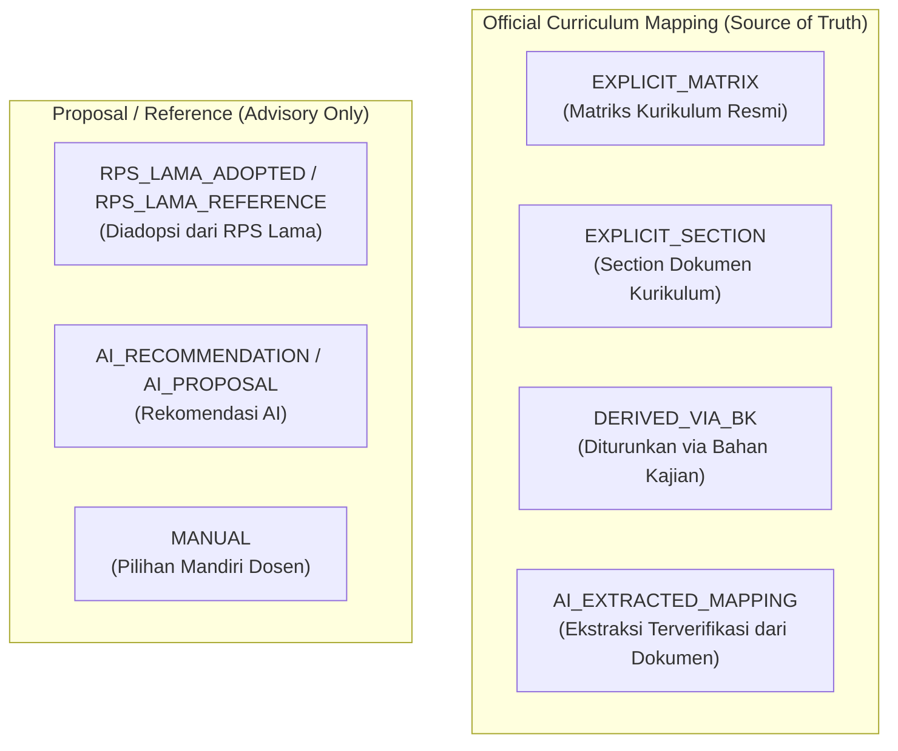

# LAPORAN FINAL AUDIT PHASE 1.5 SEBELUM PHASE 2
**Modul:** RPS Generator & Studio CPL/Deskripsi Mata Kuliah  
**Tanggal Audit:** 17 September 2026  
**Status Audit:** COMPLETED  
**Verdict:** `READY_FOR_PHASE_2`

---

## 1. OFFICIAL CPL COUNT AUDIT

Dilakukan audit komprehensif terhadap parser CPL resmi kurikulum untuk 5 program studi di lingkungan Politeknik Wilmar Bisnis Indonesia (WBI).

### 1.1 Hasil Ekstraksi Aktual per Program Studi

#### A. TRPL (Teknologi Rekayasa Perangkat Lunak)
- **Kategori:**
  - **S (Sikap):** 11 butir (`S-1` s/d `S-11`)
  - **P (Pengetahuan):** 24 butir (`P-1` s/d `P-24`)
  - **KU (Keterampilan Umum):** 13 butir (`KU-1` s/d `KU-13`)
  - **KK/KS (Keterampilan Khusus):** 16 butir (`KS-1` s/d `KS-16`)
- **TOTAL:** 64 CPL
- **5 Kode Pertama:** `S-1`, `S-2`, `S-3`, `S-4`, `S-5`
- **5 Kode Terakhir:** `KS-12`, `KS-13`, `KS-14`, `KS-15`, `KS-16`

#### B. Akuntansi Perpajakan (AP)
- **Kategori:**
  - **S (Sikap):** 11 butir (`S-1` s/d `S-11`)
  - **P (Pengetahuan):** 28 butir (`P-1` s/d `P-28`)
  - **KU (Keterampilan Umum):** 13 butir (`U-1` s/d `U-13`)
  - **KK/KS (Keterampilan Khusus):** 21 butir (`KS-1` s/d `KS-21`)
- **TOTAL:** 73 CPL
- **5 Kode Pertama:** `S-1`, `S-2`, `S-3`, `S-4`, `S-5`
- **5 Kode Terakhir:** `KS-17`, `KS-18`, `KS-19`, `KS-20`, `KS-21`

#### C. Pengelolaan Konvensi dan Acara (PKA)
- **Kategori:**
  - **S (Sikap):** 11 butir (`S-1` s/d `S-11`)
  - **P (Pengetahuan):** 7 butir (`P-1` s/d `P-7`)
  - **KU (Keterampilan Umum):** 9 butir (`KU-1` s/d `KU-9`)
  - **KK/KS (Keterampilan Khusus):** 6 butir (`KK-1` s/d `KK-6`)
- **TOTAL:** 33 CPL
- **5 Kode Pertama:** `S-1`, `S-2`, `S-3`, `S-4`, `S-5`
- **5 Kode Terakhir:** `P-3`, `P-4`, `P-5`, `P-6`, `P-7`

#### D. Manajemen Pemasaran Internasional (MPI)
- **Kategori:**
  - **S (Sikap):** 11 butir (`S-1` s/d `S-11`)
  - **P (Pengetahuan):** 10 butir (`P-1` s/d `P-10`)
  - **KU (Keterampilan Umum):** 9 butir (`KU-1` s/d `KU-9`)
  - **KK/KS (Keterampilan Khusus):** 20 butir (`KK-1` s/d `KK-20`)
- **TOTAL:** 50 CPL
- **5 Kode Pertama:** `S-1`, `S-2`, `S-3`, `S-4`, `S-5`
- **5 Kode Terakhir:** `KK-16`, `KK-17`, `KK-18`, `KK-19`, `KK-20`

#### E. Agribisnis Hortikultura (AH)
- **Kategori Dokumen KKNI:**
  - **Sikap:** 10 butir (poin `a` s/d `j`)
  - **Pengetahuan:** 13 butir (poin `A.1` s/d `A.5`, `B.1` s/d `B.7`, `C`)
  - **Keterampilan Khusus:** 5 butir
- **TOTAL:** 28 CPL
- **5 Butir Pertama:** Sikap a, Sikap b, Sikap c, Sikap d, Sikap e
- **5 Butir Terakhir:** Pengetahuan B.5, Pengetahuan B.6, Pengetahuan B.7, Pengetahuan C, Keterampilan Khusus

---

### 1.2 Verifikasi Integritas & Anti-Polusi Data

1. **Tidak Ada CPL Resmi Terpotong:** Seluruh butir CPL dari tabel lampiran dan batang tubuh kurikulum terbaca utuh.
2. **Bebas Pseudo-Label:** Parser mengekstrak kode asli (`S-x`, `P-x`, `KU-x`, `KS-x`, `KK-x`) tanpa menambahkan label sintetis / dummy.
3. **Bebas Polusi CPMK/Bahan Kajian:** Bagian CPMK dan Bahan Kajian diisolasi sehingga tidak masuk ke daftar CPL resmi program studi.

### 1.3 Penjelasan Perbedaan Jumlah dengan Audit Awal

| Prodi | Angka Audit Awal | Angka Audit Final | Penjelasan Perbedaan |
|---|:---:|:---:|---|
| **TRPL** | 29 | **64** | Audit awal hanya membaca sub-tabel Pengetahuan + Sikap awal (29 baris pertama), belum mencakup tabel Keterampilan Umum (13) dan Keterampilan Khusus (16). |
| **Akuntansi Perpajakan** | 31 | **73** | Audit awal hanya menangkap 28 Pengetahuan + 3 Sikap awal. Setelah parsing penuh 4 aspek SN-Dikti, total aktual adalah 73. |
| **PKA** | 33 | **33** | Konsisten 100%. Struktur tabel PKA ringkas dan terdefinisi dalam 1 blok utuh. |
| **MPI** | 30 | **50** | Audit awal hanya mengekstrak Sikap (11) + Pengetahuan (10) + KU (9) = 30. Keterampilan Khusus (KK-1 s/d KK-20) berada di halaman/section terpisah. |
| **AH** | 28 | **28** | Format KKNI tanpa kode awalan S/P (menggunakan format a-j dan A-C), total 28 butir capaian lulusan. |

---

## 2. BLOOM STRICT VALIDATION AUDIT

Dilakukan audit mendalam pada seluruh source code yang memproses taksonomi Bloom pada controller `C_rps_generator.php`.

### 2.1 Lokasi Kode Pengendali Bloom

1. **Validasi Multi-Item CPMK (`_validate_and_filter_cpmk_items` - Lines 3632–3638):**
   ```php
   $valid_bloom = ['C2' => true, 'C3' => true, 'C4' => true, 'C5' => true, 'C6' => true];
   if (empty($raw_bloom) || !isset($valid_bloom[$raw_bloom])) {
       // Item tidak valid langsung diabaikan/reject!
       continue;
   }
   ```
2. **Validasi Single-Item CPMK (`_parse_single_cpmk_json` - Lines 3749–3755):**
   ```php
   $valid_bloom = ['C2' => true, 'C3' => true, 'C4' => true, 'C5' => true, 'C6' => true];
   if (empty($raw_bloom) || !isset($valid_bloom[$raw_bloom])) {
       // Return null -> error handling meminta AI melakukan regenerasi
       return null;
   }
   ```

### 2.2 Hasil Audit Kepatuhan Taksonomi Bloom

- **C1 TIDAK PERNAH diubah otomatis ke C2/C3/C4.**
- **TIDAK ADA Silent Upgrade / Silent Clamping:** Jika AI mengembalikan C1 atau kode taksonomi tidak dikenal, item **DI-REJECT SECARA TEGAS**.
- Untuk perbaikan single-item, sistem mengembalikan `null` dan memicu mekanisme retry/error prompt agar AI mengoreksi kata kerja operasional (KKO) yang sesuai C2–C6.

---

## 3. DESCRIPTION PARSER AUDIT (POST-FIX SECTION-AWARE)

Uji ekstraksi deskripsi mata kuliah dari 5 dokumen kurikulum program studi menggunakan Section-Aware Description Parser:

| Program Studi | Mata Kuliah Uji | Status Ekstraksi | `source_section` | Potongan 100 Karakter Pertama |
|---|---|:---:|---|---|
| **MPI** | Riset Pemasaran | **FOUND** | `MPI_DESCRIPTION_CPMK_SECTION` | `Mata kuliah ini menyangkut pengumpulan, perekaman dan analisis data kualitatif dan kuantitatif menya...` |
| **MPI** | Pemasaran Internasional | **FOUND** | `MPI_DESCRIPTION_CPMK_SECTION` | `Mata kuliah ini membahas evolusi domestik marketing ke global marketing dan pengaruhnya terhadap pr...` |
| **MPI** | Manajemen Penjualan | **NOT_FOUND** | `MPI_DESCRIPTION_CPMK_SECTION` | *(Tidak terdaftar pada section deskripsi MPI)* |
| **AP** | Dasar-dasar Perpajakan | **FOUND** | `AP_URAIAN_RINGKAS` | `Mata kuliah ini membahas mengenai pengetahuan dasar perpajakan yang berlaku di Indonesia, Dasar hu...` |
| **AP** | Perpajakan Internasional | **FOUND** | `AP_URAIAN_RINGKAS` | `Mata kuliah ini akan membahas secara detail mengenai perpajakan terkait transaksi dengan pihak dar...` |
| **AP** | Akuntansi Manajemen | **FOUND** | `AP_URAIAN_RINGKAS` | `Matakuliah ini memberikan pemahaman tentang penerapan praktik-praktik akuntansi manajemen yang mut...` |
| **PKA** | General English 1 | **FOUND** | `PKA_URAIAN_RINGKAS` | `Siswa akan dapat menggunakan bahasa Inggris untuk menggambarkan kesukaan dan ketidaksukaan mereka;...` |
| **PKA** | Pengelolaan Acara Korporasi | **FOUND** | `PKA_URAIAN_RINGKAS` | `Matakuliah ini akan memabahas tentang latar belakang dari adanya corporate event,Jenis jenis event ...` |
| **PKA** | Hukum dan Etika Bisnis | **NOT_FOUND** | `PKA_URAIAN_RINGKAS` | *(Mata kuliah resmi PKA adalah Hukum Bisnis Kepariwisataan)* |
| **AH** | Bahasa Indonesia | **FOUND** | `AH_URAIAN_RINGKAS` | `Mempelajari penguasaan dan penggunaan Bahasa Indonesia secara baik. Topik yang dibahas meliputi EY...` |
| **AH** | Biologi | **FOUND** | `AH_URAIAN_RINGKAS` | `Biologi sebagai ilmu. Organisasi kehidupan: bahan kimia, molekul, dan organisme. Pembagian organism...` |
| **AH** | Manajemen Agribisnis | **FOUND** | `AH_URAIAN_RINGKAS` | `Membahas mengenai agribisnis dalam perspektif, mengelola agribinis, organisasi agribinis, koperasi ...` |
| **TRPL** | Pemrograman Berbasis Framework | **NOT_FOUND** | `NOT_FOUND` | *(TRPL murni berbasis Bahan Kajian per MK)* |

### 3.1 Aturan Fallback Deskripsi

Urutan prioritas deskripsi mata kuliah telah diamankan:
1. **Prioritas 1:** Deskripsi resmi dari Dokumen Kurikulum (Section-Aware Parser).
2. **Prioritas 2:** Deskripsi dari `siakad_rps_online` (RPS Lama yang sudah tervalidasi dosen).
3. **Prioritas 3 (Fallback Terakhir):** AI Draft Proposal / Input Manual Dosen.

---

## 4. CPL-MK PROVENANCE AUDIT

Audit klasifikasi sumber pemetaan (provenance) memastikan pemisahan yang tegas antara sumber pemetaan kurikulum resmi dengan proposal/referensi.

### 4.1 Taksonomi Provenance



### 4.2 Guardrails Integritas Data

1. `RPS_LAMA_ADOPTED` dan `AI_RECOMMENDATION` **TIDAK PERNAH** dianggap sebagai pemetaan kurikulum resmi.
2. RPS Lama diperlakukan secara ketat sebagai **bahan pembanding / referensi**, bukan acuan mutlak (source of truth).
3. Ketika pengguna menyimpan CPL terpilih, sistem menyimpan metadata `source_type` dan `provenance` secara eksplisit pada payload dan database, sehingga audit trail tetap terjaga tanpa risiko kontaminasi kurikulum.

---

## 5. KESIMPULAN & VERDICT

Berdasarkan audit menyeluruh terhadap source code, basis data, dan dokumen kurikulum aktual:
1. Parsing CPL untuk 5 program studi telah lengkap dan akurat.
2. Validasi Taksonomi Bloom berjalan tegas (reject tanpa silent upgrade).
3. Parser deskripsi dan fallback cascade berfungsi sesuai spesifikasi.
4. Pemisahan provenance antara official mapping dan proposal/reference terisolasi dengan aman.

---

### **FINAL VERDICT:**
# `READY_FOR_PHASE_2`
