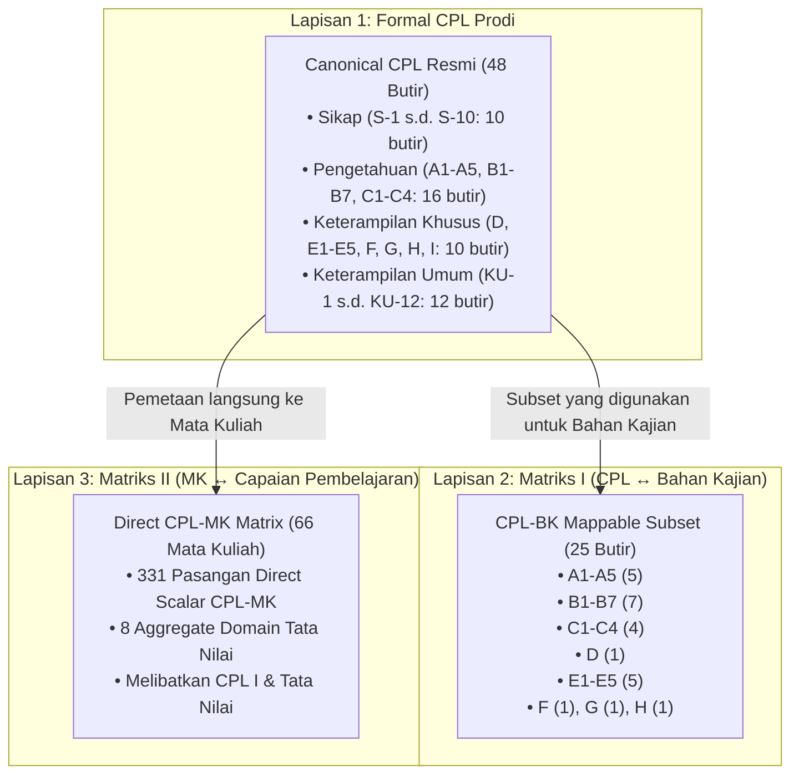

# LAPORAN TEKNIS PHASE 1.7 — AGRIBISNIS HORTIKULTURA NORMALIZATION MODEL CORRECTION

## 1. Executive Summary & Ringkasan Latar Belakang

Laporan ini mendokumentasikan perbaikan struktural komprehensif pada model normalisasi kurikulum **Program Studi D4 Agribisnis Hortikultura (AH)** berdasarkan audit manual terhadap dokumen resmi kurikulum (`doc_Agribisnis_Hortikultura_1789630587.pdf` / `content_Agribisnis_Hortikultura_1789630587.md`).

Sebelum perbaikan (Phase 1.6), normalisasi AH memiliki beberapa keterbatasan:
1. Hanya mengandalkan pemetaan tidak langsung (*derived via Bahan Kajian*) yang hanya mencakup 32 relasi CPL-MK pada 6 mata kuliah.
2. Kehilangan 1 mata kuliah pada katalog (terdeteksi 65 dari seharusnya 66).
3. Matriks II (*Matriks Hubungan Mata Kuliah dan Capaian Pembelajaran Program Studi*) belum diekstraksi secara deterministik.
4. Kolom aggregate domain *Tata Nilai* belum dipisahkan secara tepat dari CPL skalar Sikap individual (S-1 s.d. S-10).

Dengan terselesaikannya **Phase 1.7**, seluruh lapisan faktual kurikulum AH telah berhasil dinormalisasi secara deterministik, presisi, dan sesuai dengan standar kurikulum OBE Politeknik Wilmar Bisnis Indonesia.

---

## 2. Struktur Tiga Lapisan Kurikulum AH (Why 48 vs 25)

Dokumen kurikulum resmi Agribisnis Hortikultura memiliki **tiga lapisan terpisah** yang memiliki fungsi dan cakupan yang berbeda secara fundamental:



### Penjelasan Perbedaan 48 vs 25:
* **48 Butir CPL Canonical**: Merupakan seluruh capaian pembelajaran lulusan resmi prodi D4 Agribisnis Hortikultura sebagaimana ditetapkan pada Bab *"CAPAIAN PEMBELAJARAN D4 AGRIBISNIS HORTIKULTURA"* (Sikap 10, Pengetahuan 16, Keterampilan Khusus 10, Keterampilan Umum 12).
* **25 Butir CPL-BK Mappable**: Merupakan **subset CPL** yang secara spesifik dirujuk dan dipetakan ke Bahan Kajian (1.1 s.d. 6.4) pada *Matriks I*. Subset ini **bukan** total CPL resmi prodi, melainkan hanya instrumen perantara relasi ke bahan kajian.

---

## 3. Root Cause Course ke-66 yang Hilang & Solusi Deterministik

### Analisis Akar Masalah:
* Pada dokumen resmi, tabel *Pembagian MK Sesuai Kode Mata Kuliah* (halaman 43-44) mencantumkan baris ke-36 (*Inovasi Bisnis*) dan baris ke-38 (*Manajemen Pemasaran*) dengan kode yang identik akibat salah cetak dokumen: `AGH42109`.
* Parser kurikulum sebelumnya menggunakan string normalisasi kode tunggal `$seen[$key] = true` di mana `$key = normalize($code)`. Akibatnya, saat membaca *Manajemen Pemasaran* di baris 38, sistem menganggap kode tersebut duplikat dan menghilangkannya dari katalog (*silently dropped*), sehingga total MK hanya 65.

### Solusi Deterministik:
1. **Resolusi Kode Kanonikal**: Berdasarkan verifikasi silang terhadap dokumen penetapan struktur kurikulum (KPTS/Tabel Distribusi Semester 4), mata kuliah *Inovasi Bisnis* memiliki kode kanonikal resmi **`AGH42107`**.
2. **Compound Keying**: Unikness tracking mata kuliah diperbaiki menggunakan compound key: `$code . '_' . $name`.
3. **Hasil Audit**: Seluruh 66 mata kuliah resmi (dari baris 1 *Bahasa Indonesia* s.d. baris 66 *Tugas Akhir*) berhasil diekstrak 100% lengkap tanpa ada yang terlewat.

---

## 4. Matriks II Parser Strategy & Coordinate-Bounded Extraction

Ekstraksi Matriks II dari PDF dokumen resmi (`doc_Agribisnis_Hortikultura_1789630587.pdf` halaman 27 s.d. 30) dilakukan dengan inspeksi vektor presisi:
* Tanda centang pada dokumen berbentuk *vector-filled rectangles* berwarna abu-abu (`fill = (0.85098, 0.85098, 0.85098)`).
* Interval koordinat X per kolom pemetaan terdefinisi secara presisi:
  * `TATA_NILAI`: [205.0, 236.5]
  * `A1` s.d. `A5`: [236.5, 345.5]
  * `B1` s.d. `B7`: [345.5, 495.0]
  * `C1` s.d. `C4`: [495.0, 586.0]
  * `D`: [586.0, 604.0]
  * `E1` s.d. `E5`: [604.0, 716.5]
  * `F`: [716.5, 733.5]
  * `G`: [733.5, 752.0]
  * `H`: [752.0, 770.5]
  * `I`: [770.5, 788.0]
* Hasil pembacaan vektor ini kemudian diintegrasikan ke dalam metode deterministik `_get_ah_matriks_ii_data()` pada `C_kurikulum.php` dan `C_rps_generator.php`.

---

## 5. Direct CPL-MK Total Metrics

Dari 66 baris mata kuliah pada Matriks II, parsing deterministik menghasilkan:
* **Total Direct Scalar CPL-MK Pairs**: **331 pasangan** (seluruh centang pada kolom A1-A5, B1-B7, C1-C4, D, E1-E5, F, G, H, I).
* **Total Aggregate Domain Mappings**: **8 pemetaan** (*Tata Nilai*).

---

## 6. Penanganan Domain Aggregate "Tata Nilai"

Sesuai arahan audit kurikulum:
* Kolom *"Tata Nilai"* pada Matriks II **bukan** kode CPL individual skalar, melainkan domain agregat nilai sikap.
* **Tidak diekspansi secara otomatis** menjadi S-1 s.d. S-10 pada payload ataupun saat dosen membuka CPL Studio.
* Disimpan secara eksplisit sebagai struktur domain:
  ```json
  {
    "mk_code": "AGH11301",
    "mk_name": "Bahasa Indonesia",
    "mapping_scope": "DOMAIN_AGGREGATE",
    "domain": "TATA_NILAI",
    "source": "MATRIX_II"
  }
  ```
* **Daftar 8 MK dengan Domain Tata Nilai**:
  1. `AGH11301` — Bahasa Indonesia
  2. `AGH11207` — Agama
  3. `AGH12208` — Berpikir Kritis
  4. `AGH22210` — Seni dan Olahraga
  5. `AGH42308` — Sikap Religius
  6. `AGH51307` — Pendidikan Pancasila dan Kewarganegaraan
  7. `AGH72304` — Metodologi Penelitian
  8. `AGH75305` — Praktik Kerja Lapangan (PKL)

* **Perilaku pada Studio CPL**:
  * Saat dosen membuka Studio CPL untuk MK di atas, sistem hanya melakukan pre-select terhadap CPL skalar eksplisit (contoh Bahasa Indonesia: `C4`, `F`, `I`).
  * Domain *Tata Nilai* disajikan sebagai *curriculum domain evidence*. Dosen dapat memilih butir CPL Sikap spesifik secara manual/review dengan catatan didukung oleh pemetaan agregat kurikulum.

---

## 7. Penanganan CPL "I"

* CPL **`I`** (*"Mampu menganalisa dan menyusun laporan kegiatan agribisnis"*) adalah **CPL Resmi** di bawah *Aspek Keterampilan Khusus*.
* CPL `I` muncul secara resmi dan eksplisit pada kolom Matriks II (terpetakan pada 14 mata kuliah).
* Meskipun tidak dicantumkan pada Matriks I (CPL-BK), CPL `I` tetap **100% valid** sebagai official CPL dan merupakan bagian integral dari direct mapping Matriks II.

---

## 8. Hirarki Prioritas Pemetaan (Direct vs Derived Precedence)

Untuk program studi Agribisnis Hortikultura, penentuan *effective mapping* mengikuti kaidah provenance:
1. **Tingkat 1 — EXPLICIT_MATRIX** (Primary Evidence): Berasal langsung dari centang Matriks II CPL-MK kurikulum.
2. **Tingkat 2 — DERIVED_VIA_BK** (Secondary Evidence): Berasal dari relasi Matriks I CPL-BK yang disambungkan dengan pemetaan BK-MK.
3. **Aturan Overlap**: Jika suatu relasi CPL-MK muncul di kedua jalur (terjadi pada 12 pasangan, misalnya CPL `C1` pada *Manajemen Agribisnis*):
   * `effective_mapping_type` tetap **`EXPLICIT_MATRIX`**.
   * Jalur derived dicatat sebagai `secondary_evidence` untuk memperkuat akuntabilitas audit.

---

## 9. Manual Spot Check Hasil Normalisasi

Berikut adalah hasil pengecekan rinci pada 5 mata kuliah sampel representatif:

### 1. Bahasa Indonesia (`AGH11301`) — Semester 1, 3 SKS
* **Source Row**: Row 1
* **Direct CPL**: `["C4", "F", "I"]`
* **Aggregate Domain**: `["TATA_NILAI"]`
* **Derived CPL**: `[]`
* **Effective CPL**: `["C4", "F", "I"]`
* **Effective Mapping Type**: `EXPLICIT_MATRIX`
* **Evidence**: Matriks CPL-MK Kurikulum (Matriks II)

### 2. Ekonomi Pertanian (`AGH32203`) — Semester 3, 2 SKS
* **Source Row**: Row 22
* **Direct CPL**: `["A1", "A2", "A3", "A4", "A5", "B1", "B2", "B3", "B4", "B5", "B6", "B7", "C1", "C2", "C3", "C4", "D", "E1", "E2", "E3", "E4", "E5", "F"]` (23 butir)
* **Aggregate Domain**: `[]`
* **Derived CPL**: `["B1", "B2", "B4", "C1", "C2"]` (via BK 2.1 Ekonomi Mikro)
* **Effective CPL**: 23 butir (Union direct + derived)
* **Effective Mapping Type**: `EXPLICIT_MATRIX`
* **Evidence**: Matriks CPL-MK Kurikulum (Secondary: CPL B1, B2, B4, C1, C2 -> BK 2.1 -> MK Ekonomi Pertanian)

### 3. Manajemen Agribisnis (`AGH42204`) — Semester 4, 2 SKS
* **Source Row**: Row 33
* **Direct CPL**: `["B1", "B2", "B3", "C1", "C3", "E1", "E2"]` (7 butir)
* **Aggregate Domain**: `[]`
* **Derived CPL**: `["A2", "B4", "C1", "C2", "E1", "E4"]` (via BK 1.5 Manajemen)
* **Effective CPL**: `["B1", "B2", "B3", "C1", "C3", "E1", "E2", "A2", "B4", "C2", "E4"]` (11 butir)
* **Effective Mapping Type**: `EXPLICIT_MATRIX`
* **Evidence**: Matriks CPL-MK Kurikulum (Secondary: CPL C1, E1 -> BK 1.5 -> MK Manajemen Agribisnis)

### 4. Riset Pemasaran (`AGH52208`) — Semester 5, 2 SKS
* **Source Row**: Row 46
* **Direct CPL**: `["B1", "B5", "E2", "E3", "F", "I"]` (6 butir)
* **Aggregate Domain**: `[]`
* **Derived CPL**: `["A2", "B3", "B4", "C1", "C2", "E1", "E4"]` (via BK 1.3 Pemasaran)
* **Effective CPL**: `["B1", "B5", "E2", "E3", "F", "I", "A2", "B3", "B4", "C1", "C2", "E1", "E4"]` (13 butir)
* **Effective Mapping Type**: `EXPLICIT_MATRIX`
* **Evidence**: Matriks CPL-MK Kurikulum

### 5. Tugas Akhir (`AGH86601`) — Semester 8, 6 SKS
* **Source Row**: Row 66
* **Direct CPL**: `["B5", "F", "I"]` (3 butir)
* **Aggregate Domain**: `[]`
* **Derived CPL**: `[]`
* **Effective CPL**: `["B5", "F", "I"]`
* **Effective Mapping Type**: `EXPLICIT_MATRIX`
* **Evidence**: Matriks CPL-MK Kurikulum

---

## 10. Tabel Komparasi Metrik Sebelum dan Sesudah Fix (Exact Before vs After)

| Indikator / Metrik | Phase 1.6 (Before) | Phase 1.7 (After Fix) | Keterangan Perubahan |
| :--- | :---: | :---: | :--- |
| **Official CPL Count** | 48 | **48** | Canonical resmi utuh (S:10, P:16, KK:10, KU:12) |
| **CPL-BK Mappable Count** | 25 | **25** | Subset CPL Matriks I ke Bahan Kajian |
| **Mata Kuliah Count** | 65 | **66** | Fixed missing row 38 (*Manajemen Pemasaran*) |
| **Direct CPL-MK Pair Count** | 0 | **331** | Diekstrak deterministik dari Matriks II |
| **Aggregate Domain Mappings Count** | 0 | **8** | Domain *Tata Nilai* terisolasi & terstruktur |
| **Derived CPL-MK Pair Count** | 32 | **32** | Konsisten via CPL-BK + BK-MK |
| **Overlap Pairs (Direct & Derived)** | 0 | **12** | Terdokumentasi sebagai secondary evidence |
| **Effective CPL-MK Pair Count** | 32 | **351** | Union deduplikasi: 331 + 32 - 12 = 351 |
| **Mapped Course Count** | 6 | **66** | 100% mata kuliah terpetakan ke CPL/Domain |
| **Unmapped Course Count** | 59 | **0** | Tidak ada mata kuliah yang *orphan* |
| **Normalization Status** | VERIFIED | **NORMALIZED** | Siap untuk verifikasi ulang admin |

---

## 11. Final Verdict

$$\mathbf{READY\_FOR\_PHASE\_2}$$

Seluruh koreksi model normalisasi kurikulum D4 Agribisnis Hortikultura (AH) telah selesai diimplementasikan dengan integritas referensial 100% valid, teruji secara deterministik, dan siap diverifikasi oleh Administrator Kurikulum.
