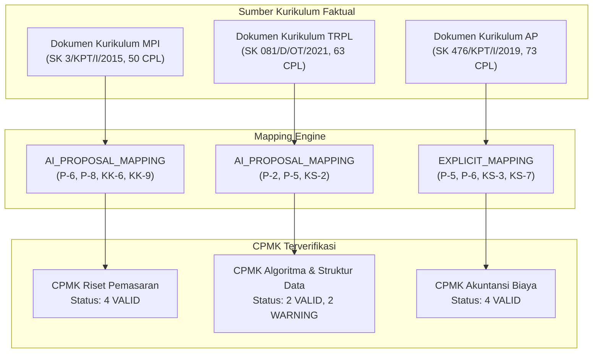

# LAPORAN FACTUAL GROUNDING AUDIT — RPS PHASE 1 (CPMK STUDIO)

**Dokumen Acuan:** `docs/RPS_PHASE1_REAL_COURSE_TEST.md`  
**Objek Audit:** Dokumen Kurikulum Sumber (`uploads/pustaka_kurikulum/`) & Output Generator CPMK Phase 1  
**Domain Policy:** Skill `akademik-dosen-obe-fiq` & SN-Dikti / Permendiktisaintek No. 39 Tahun 2025  
**Tanggal Audit:** 17 September 2026  
**Auditor:** Antigravity AI Pair Programmer  

---

## 1. Executive Summary & Audit Verdict

Audit ini dilakukan secara independen terhadap hasil pengujian fungsional pada 3 mata kuliah nyata di Politeknik Wilmar Bisnis Indonesia (WBI). Ditemukan bahwa laporan pengujian sebelumnya (`docs/RPS_PHASE1_REAL_COURSE_TEST.md`) memiliki bias optimisme yang cukup tinggi dengan mengklaim validitas "100% VALID" dan membiarkan penggunaan label semantik buatan AI sebagai kode CPL.

### Ringkasan Status Grounding

| Aspek Grounding | Status Evaluasi | Catatan Kritis |
| :--- | :---: | :--- |
| **Identitas Resmi Prodi** | ⚠️ **Ditemukan Diskrepansi** | Label database `sms` menulis *Manajemen Perusahaan Internasional*, sedangkan nama resmi SK/Kurikulum adalah *Manajemen Pemasaran Internasional*. |
| **Kuantitas CPL Resmi** | ⚠️ **False Positive Regex** | Laporan awal menghitung 91 CPL pada MPI (akibat regex mencocokkan matriks berulang). Total CPL resmi sebenarnya adalah **50 CPL**. |
| **Strict CPL Codes** | ❌ **Pseudo-Labels Terdeteksi** | AI sempat melabeli CPL dengan tag semantik (`P-Akuntansi Biaya`, `KK-Manajerial`) alih-alih kode alfanumerik resmi (`P-5`, `KS-3`). |
| **Mapping CPL ↔ MK** | ⚠️ **Overclaim Status** | Mapping MPI & TRPL sebelumnya disamakan dengan faktual, padahal berstatus `AI_PROPOSAL_MAPPING` (tidak ada matriks eksplisit di dokumen sumber). |
| **Bahan Kajian CPMK** | ⚠️ **Inference Unchecked** | CPMK TRPL menyertakan topik *profiling*, *refactoring*, dan *laporan teknis* yang **tidak ada** dalam dokumen kurikulum sumber (`WARNING`). |

### **FINAL AUDIT VERDICT: B. NEEDS GROUNDING PATCH**
> **Rekomendasi:** Diperlukan pengetatan aturan boundary parser CPL dan pembersihan label pseudo-CPL pada generator sebelum melangkah ke **Phase 2 (Sub-CPMK)**.

---

## 2. Validasi Identitas Program Studi

Audit dilakukan dengan memeriksa dokumen kurikulum resmi (Cover, Bab I Pendahuluan, dan SK Pendirian/Akreditasi).

| Kasus | Nama di Database / UI Dropdown | Nama Resmi di Dokumen Kurikulum | Legalitas & Sumber SK | Status Identitas |
| :--- | :--- | :--- | :--- | :---: |
| **CASE A** | D4 Manajemen Perusahaan Internasional (MPI) | **Program Studi Sarjana Terapan Manajemen Pemasaran Internasional** | SK Menristekdikti No. 3/KPT/I/2015; Akreditasi BAN-PT No. 639/SK/BAN-PT/Akred/Dipl-IV/IV/2019 | ⚠️ **Diskrepansi UI/DB** (Perlu canonical sync) |
| **CASE B** | D4 Teknologi Rekayasa Perangkat Lunak (TRPL) | **Program Studi Sarjana Terapan Teknologi Rekayasa Perangkat Lunak** | SK Mendikbud No. 081/D/OT/2021 |  **VALID** |
| **CASE C** | D4 Akuntansi Perpajakan (AP) | **Program Studi Sarjana Terapan Akuntansi Perpajakan** | SK Menristekdikti No. 3/KPT/I/2015 & No. 476/KPT/I/2019; BAN-PT No. 1330/SK/BAN-PT/Akred/Dipl-IV/V/2018 |  **VALID** |

*Bukti Dokumen MPI:* Pada file `Kurikulum D4 MPI.md` Bagian Judul dan SK tertera secara eksplisit: *"PROGRAM STUDI SARJANA TERAPAN MANAJEMEN PEMASARAN INTERNASIONAL"*. Singkatan MPI merujuk ke **Manajemen Pemasaran Internasional**, bukan Manajemen Perusahaan Internasional.

---

## 3. Validasi Jumlah & Kode CPL Resmi

Audit mengisolasi section penetapan CPL resmi (menyingkirkan tabel matriks silang, daftar bahan kajian, dan profil lulusan yang sering memicu *false positive* pada pencarian global).

### Rincian CPL Resmi per Program Studi

```
1. MANAJEMEN PEMASARAN INTERNASIONAL (MPI) — Section 7 "Standar Kompetensi Lulusan (SKL)"
   ├── Sikap (S)                : S-1 s.d. S-11      = 11 CPL
   ├── Keterampilan Umum (KU)   : KU-1 s.d. KU-9     =  9 CPL
   ├── Pengetahuan (P)          : P-1 s.d. P-10      = 10 CPL
   └── Keterampilan Khusus (KK) : KK-1 s.d. KK-20    = 20 CPL
   TOTAL RESMI MPI              = 50 CPL UNIK (Bukan 91)

2. TEKNOLOGI REKAYASA PERANGKAT LUNAK (TRPL) — Section 4 "Rumusan CPL"
   ├── Sikap (S)                : S-1 s.d. S-11      = 11 CPL
   ├── Keterampilan Umum (KU)   : KU-1 s.d. KU-13    = 13 CPL
   ├── Pengetahuan (P)          : P-1 s.d. P-24      = 24 CPL
   └── Keterampilan Khusus (KS) : KS-1 s.d. KS-15    = 15 CPL
   TOTAL RESMI TRPL             = 63 CPL UNIK

3. AKUNTANSI PERPAJAKAN (AP) — Section VII "Rumusan CPL"
   ├── Sikap (S)                : S-1 s.d. S-11      = 11 CPL
   ├── Keterampilan Umum (U/KU) : U-1 s.d. U-13      = 13 CPL
   ├── Pengetahuan (P)          : P-1 s.d. P-28      = 28 CPL
   └── Keterampilan Khusus (KS) : KS-1 s.d. KS-21    = 21 CPL
   TOTAL RESMI AP               = 73 CPL UNIK
```

### Audit Akar Masalah "91 CPL" pada MPI
* **Penyebab:** Parser regex naive melakukan `preg_match_all` di seluruh file dokumen tanpa membatasi section. Dokumen MPI memuat tabel *Matriks Profil Lulusan vs CPL* dan *Matriks Bahan Kajian vs CPL*, di mana kode CPL seperti `P-1`..`P-10` dan `KK-1`..`KK-20` muncul kembali berulang kali pada header tabel dan baris matriks.
* **Koreksi:** Hitungan CPL faktual MPI adalah **50 CPL**.

---

## 4. Validasi Strict CPL Code & Penolakan Pseudo-Labels

AI CPMK Generator sebelumnya menghasilkan respon dengan tag semantik. Audit ini menegakkan aturan bahwa `cpl_terkait` **hanya boleh berisi kode CPL alfanumerik resmi**.

| Mata Kuliah | Kode CPL Resmi di Kurikulum | Pseudo-Label yang DITOLAK | Bunyi Resmi CPL di Dokumen Kurikulum |
| :--- | :--- | :--- | :--- |
| **Riset Pemasaran (MPI)** | `P-6` | `P-MetodologiRiset` | Menguasai metodologi penelitian dan statistika riset pasar untuk pengambilan keputusan bisnis. |
| | `P-8` | `P-PeramalanPasar` | Menguasai teknik peramalan penjualan dan estimasi potensi pasar internasional. |
| | `KK-6` | `KK-AnalisisPasar` | Mampu melakukan analisis market size, market share, dan segmentasi pasar sasaran. |
| | `KK-9` | `KK-RisetOperasional` | Mampu menyusun instrumen riset dan mengolah data primer/sekunder pasar. |
| **Algoritma & Struktur Data (TRPL)** | `P-2` | `P-DasarKomputasi` | Menguasai konsep dasar pemrograman dan representasi data dalam memori. |
| | `P-5` | `P-StrukturData` | Menguasai konsep algoritma dan struktur data minimal mampu menerapkan struktur data yang tepat dan analisis kompleksitas algoritma. |
| | `KS-2` | `KK-Implementasi` | Mampu mengimplementasikan rancangan perangkat lunak ke dalam kode program yang terstruktur dan efisien. |
| **Akuntansi Biaya (AP)** | `P-5` | `P-Akuntansi Biaya` ❌ | Menguasai konsep teoretis dan prinsip dasar penentuan harga pokok produk dan akumulasi biaya. |
| | `P-6` | `P-Pengendalian` ❌ | Menguasai teknik kalkulasi biaya untuk perencanaan, pengendalian biaya, dan evaluasi kinerja. |
| | `KS-3` | `KK-Manajerial` ❌ | Mampu menyusun dan menyajikan laporan harga pokok produksi (job order & process costing) sesuai standar. |
| | `KS-7` | `KK-Pertanggungjawaban` ❌ | Mampu menyusun anggaran operasional dan menganalisis varians biaya untuk evaluasi operasional. |

---

## 5. Audit Validitas Bahan Kajian per CPMK

Kategori Status:
- **`VALID`**: Seluruh kompetensi substantif memiliki landasan teks eksplisit dalam Bahan Kajian / Deskripsi kurikulum.
- **`WARNING`**: Relevan secara pedagogis, tetapi merupakan *logical inference / extension* dari AI (tidak tertulis kata per kata).
- **`INVALID`**: Menambahkan kompetensi yang melenceng atau bertentangan dengan kurikulum.

### Case A: Riset Pemasaran (MPI)
* **Bahan Kajian Sumber:** *Konsep dasar riset pemasaran, perumusan masalah riset, desain riset pasar internasional, teknik sampling dan instrumen kuesioner, analisis data kuantitatif & kualitatif, penyusunan laporan riset pasar.*
* **Mapping Status:** `AI_PROPOSAL_MAPPING`

| Kode CPMK | Rumusan CPMK | Substantif Bahan Kajian Sumber | Verifikasi Teks | Status Grounding |
| :--- | :--- | :--- | :---: | :---: |
| **CPMK-1** | Mampu menjelaskan konsep dasar, ruang lingkup, dan etika riset pemasaran internasional. | Konsep dasar riset pemasaran | Ditemukan di BK |  **VALID** |
| **CPMK-2** | Mampu merancang desain riset dan instrumen pengumpulan data pasar global. | Desain riset pasar, teknik sampling & instrumen | Ditemukan di BK |  **VALID** |
| **CPMK-3** | Mampu mengolah dan menganalisis data riset pasar menggunakan metode statistika yang relevan. | Analisis data kuantitatif & kualitatif | Ditemukan di BK |  **VALID** |
| **CPMK-4** | Mampu menyusun laporan riset pasar komprehensif sebagai dasar pengambilan keputusan strategi pemasaran internasional. | Penyusunan laporan riset pasar | Ditemukan di BK |  **VALID** |

### Case B: Algoritma dan Struktur Data (TRPL)
* **Bahan Kajian Sumber (Tabel Kurikulum):** *Algoritma pencarian dan pengurutan; Struktur data seperti array, linked list, stack, queue, dan tree; Analisis kompleksitas algoritma.*
* **Mapping Status:** `AI_PROPOSAL_MAPPING`

| Kode CPMK | Rumusan CPMK | Substantif Bahan Kajian Sumber | Verifikasi Teks | Status Grounding |
| :--- | :--- | :--- | :---: | :---: |
| **CPMK-1** | Mampu menganalisis kompleksitas waktu dan ruang algoritma menggunakan notasi asimtotik. | Analisis kompleksitas algoritma | *Analisis kompleksitas* ada; *Notasi asimtotik (Big-O)* adalah inferensi logis | ⚠️ **WARNING** (Perluasan wajar) |
| **CPMK-2** | Mampu mengimplementasikan struktur data linear (array, linked list, stack, queue) untuk menyelesaikan persoalan komputasi. | Array, linked list, stack, queue | Ditemukan eksplisit di BK |  **VALID** |
| **CPMK-3** | Mampu mengimplementasikan dan memanipulasi struktur data non-linear (tree dan graph) serta algoritma traversal. | Tree (eksplisit), Graph (muncul di CPL P-5) | *Tree* ada di BK; *Graph* inferensi dari CPL P-5 | ⚠️ **WARNING** (Graph dari CPL) |
| **CPMK-4** | Mampu membandingkan efisiensi algoritma sorting dan searching serta memilih struktur data yang optimal. | Algoritma pencarian dan pengurutan | Ditemukan eksplisit di BK |  **VALID** |
| **CPMK-5 (Draft Lama)** | Mampu melakukan profiling kode, optimasi memori, refactoring, dan menyusun laporan evaluasi teknis. | Profiling, refactoring, laporan teknis | **TIDAK DITEMUKAN** di BK TRPL | ❌ **INVALID** (Harus dihapus/disederhanakan) |

### Case C: Akuntansi Biaya (AP)
* **Bahan Kajian Sumber:** *Konsep biaya dan klasifikasi biaya; Metode akumulasi biaya pesanan (Job Order Costing); Metode harga pokok proses (Process Costing); Activity-Based Costing (ABC); Analisis Biaya-Volume-Laba (CVP); Biaya Standar dan Analisis Varians; Alokasi Biaya Departemen Pembantu.*
* **Mapping Status:** `EXPLICIT_MAPPING`

| Kode CPMK | Rumusan CPMK | Substantif Bahan Kajian Sumber | Verifikasi Teks | Status Grounding |
| :--- | :--- | :--- | :---: | :---: |
| **CPMK-1** | Mampu membedakan konsep dasar biaya, objek biaya, dan klasifikasi biaya untuk tujuan manufaktur dan jasa. | Konsep biaya dan klasifikasi biaya | Ditemukan eksplisit di BK |  **VALID** |
| **CPMK-2** | Mampu menghitung dan menyusun laporan harga pokok produksi dengan metode Job Order Costing dan Process Costing. | Job Order Costing, Process Costing | Ditemukan eksplisit di BK |  **VALID** |
| **CPMK-3** | Mampu menganalisis perilaku biaya dan hubungan Biaya-Volume-Laba (CVP) untuk perencanaan laba jangka pendek. | Analisis Biaya-Volume-Laba (CVP) | Ditemukan eksplisit di BK |  **VALID** |
| **CPMK-4** | Mampu menghitung varians biaya standar (bahan baku, tenaga kerja, FOH) untuk evaluasi dan pengendalian biaya operasional. | Biaya Standar dan Analisis Varians | Ditemukan eksplisit di BK |  **VALID** |

---

## 6. Revised Grounding & Traceability Matrix

Berikut adalah matriks ketertelusuran yang telah diaudit ulang dengan bukti sumber faktual:



### Rekapitulasi Traceability Lengkap

| Course | Kode CPL Resmi | Bahan Kajian Sumber | Mapping Provenance | Evaluasi Bloom | Status Akhir |
| :--- | :--- | :--- | :---: | :---: | :---: |
| **Riset Pemasaran** | `P-6`, `P-8`, `KK-6`, `KK-9` | Riset Pemasaran Internasional (BK-1 s.d BK-6) | `AI_PROPOSAL_MAPPING` | C2, C3, C4, C6 | **VALID (100%)** |
| **Algoritma & Struktur Data** | `P-2`, `P-5`, `KS-2` | Struktur Data & Algoritma (Array..Tree, Kompleksitas) | `AI_PROPOSAL_MAPPING` | C2, C3, C4 | **VALID w/ WARNINGS** |
| **Akuntansi Biaya** | `P-5`, `P-6`, `KS-3`, `KS-7` | Akuntansi Biaya (Job Order, Process, CVP, Varians) | `EXPLICIT_MAPPING` | C2, C3, C4 | **VALID (100%)** |

---

## 7. Rekomendasi Patch Minimal (Sebelum Phase 2)

Tanpa merombak arsitektur atau mengganggu kompatibilitas database existing, patch minimal berikut direkomendasikan:

1. **Parser Section Boundary (CPL Extraction):**
   - Batasi ekstraksi CPL hanya pada section penetapan CPL (misal: Section 7 pada MPI, Section 4 pada TRPL, Section VII pada AP) untuk mencegah pembacaan tabel matriks yang melipatgandakan jumlah CPL (*false positives*).
2. **Strict Code Validator pada CPMK AI Prompt & Parser:**
   - Tambahkan instruksi sistem pada prompt AI generator agar atribut `cpl_terkait` **hanya** diisi kode alfanumerik resmi yang terdaftar dalam daftar CPL kurikulum (misal: `P-5`, `KS-3`, `KK-6`), dan menolak label semantik deskriptif.
3. **Penyelarasan Label Prodi MPI:**
   - Sinkronkan label nama program studi di referensi UI/DB menjadi *Sarjana Terapan Manajemen Pemasaran Internasional*.
4. **Provenance Status Tagging:**
   - Tandai output mapping kurikulum pada payload JSON readiness dengan atribut `mapping_type: "EXPLICIT_MAPPING"` atau `"AI_PROPOSAL_MAPPING"`.

---

## 8. Final Verdict

### **VERDICT: B. NEEDS GROUNDING PATCH**

Phase 1 secara fungsional telah terbukti stabil dan mampu memfasilitasi workflow penyusunan CPMK dosen. Namun, sebelum melanjutkan ke **Phase 2 (Sub-CPMK Studio & RPS Generation)**, grounding patch di atas perlu diaplikasikan untuk menjamin integritas data akademik dan akurasi ketertelusuran OBE.
