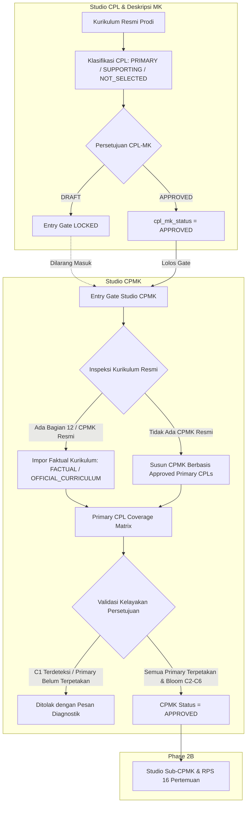

# DOKUMENTASI SISTEM STUDIO CPMK (PHASE 2A)
## Official CPMK First + Approved CPL Grounding + Bloom C2–C6 + Matrix Coverage

**Status Dokumen**: `FINAL APPROVED`  
**Tahap**: Phase 2A — Studio CPMK  
**Keputusan / Verdict**: `STUDIO_CPMK_READY_FOR_SUB_CPMK`  
**Target Rilis**: Portal Dosen WBI — Generator RPS OBE (SN-Dikti / Permendiktisaintek No. 39/2025 & No. 10/2026)

---

## 1. Ringkasan Eksekutif & Arsitektur Phase 2A

Studio CPMK adalah modul tahap kedua pada arsitektur penyusunan RPS OBE Politeknik Wilmar Bisnis Indonesia (WBI). Modul ini bertugas menyusun, memvalidasi, dan mengunci butir Capaian Pembelajaran Mata Kuliah (CPMK) dengan jaminan kepatuhan terhadap prinsip:
1. **Source-First (Official CPMK First)**: Jika dokumen kurikulum resmi program studi telah mendefinisikan CPMK untuk mata kuliah tersebut (misalnya Bagian 12 pada kurikulum Manajemen Pemasaran Internasional), sistem mengimpor teks resmi tersebut dengan provenansi `FACTUAL` (`OFFICIAL_CURRICULUM`). AI dilarang keras menimpa teks resmi kurikulum secara otomatis.
2. **Approved CPL Grounding**: Studio CPMK hanya menerima input dari Studio CPL yang telah berstatus `APPROVED`. Butir CPL berstatus `PRIMARY` berfungsi sebagai pemicu kompetensi utama (*direct drivers*), sedangkan CPL `SUPPORTING` menjadi batasan transversal. CPL yang tidak dipilih (`NOT_SELECTED_FOR_RPS`) atau `UNCLASSIFIED` tidak boleh digunakan sebagai driver CPMK.
3. **Taksonomi Bloom Terstandar ($C2..C6$)**: Setiap butir CPMK wajib berada pada domain kognitif tingkat pemahaman hingga penciptaan ($C2$ s.d. $C6$). Kategori $C1$ (sekadar mengingat/hafalan) **ditolak secara eksplisit** oleh sistem validasi dan tidak dinaikkan secara diam-diam.
4. **100% Primary Coverage Matrix**: Setiap butir CPL `PRIMARY` yang disetujui pada Studio CPL wajib dipetakan ke minimal satu butir CPMK. Sistem menyajikan matriks cakupan interaktif secara visual.
5. **Kaskade Invalidasi Hilir**: Apabila Studio CPL diubah atau dibuka kembali untuk revisi (kembali ke `DRAFT`), status Studio CPMK secara otomatis diinvalidasi kembali menjadi `DRAFT`.



---

## 2. Spesifikasi Entry Gate & Status

Studio CPMK menerapkan gerbang akses ketat (*strict entry gate*):

| Kondisi `cpl_mk_status` | Respons Backend (`ajax_get_cpmk_studio`) | Tampilan UI Canvas Studio CPMK |
| :--- | :--- | :--- |
| `DRAFT` / `null` | `status: false, gate_locked: true` | Banner peringatan kuning terkunci (`Studio CPMK Terkunci`), tombol simpan/setujui dinonaktifkan, menyediakan tombol pintas kembali ke Studio CPL. |
| `APPROVED` | `status: true, gate_locked: false` | Canvas terbuka penuh: memuat banner kurikulum, ringkasan CPL grounding, matriks interaktif, kartu-kartu butir CPMK. |

---

## 3. Algoritma Deteksi Official CPMK First

Metode `_detect_official_course_cpmk($pustaka_content, $kode_mk, $nama_mk, $prodi_name, $structured_payload)` bekerja secara deterministik tanpa bergantung pada LLM non-deterministik:

1. **Pemeriksaan Bagian Kurikulum**: Mencari segmen *"12. Deskripsi Dan Capaian Pembelajaran Mata Kuliah"* atau format ekuivalen pada berkas markdown kurikulum prodi.
2. **Pencocokan Mata Kuliah**: Menelusuri judul mata kuliah menggunakan regex kode MK dan alias nama mata kuliah (misal: `Penelitian Pemasaran` vs `Riset Pemasaran`).
3. **Pemisahan Deskripsi vs CPMK**: Memisahkan blok kalimat deskripsi mata kuliah dan blok butir capaian pembelajaran mata kuliah.
4. **Penetapan Provenansi**:
   - `provenance` = `FACTUAL`
   - `source_type` = `OFFICIAL_CURRICULUM`
   - `source_section` = `12. Deskripsi Dan Capaian Pembelajaran Mata Kuliah`
   - `level_bloom` = Dideteksi otomatis berdasarkan kata kerja operasional ($C2..C6$).
   - `editable` = `true` (saat berstatus DRAFT)

---

## 4. Struktur Data Butir CPMK (`cpmk_json`)

Setiap butir CPMK disimpan dalam kolom `cpmk_json` tabel `siakad_rps_obe` dengan skema baku:

```json
[
  {
    "id": "cpmk_1",
    "code": "CPMK-1",
    "kode": "CPMK-1",
    "rumusan": "Mampu menganalisis dan merancang arsitektur perangkat lunak berbasis komponen modular.",
    "teks": "Mampu menganalisis dan merancang arsitektur perangkat lunak berbasis komponen modular.",
    "level_bloom": "C4",
    "primary_cpl": ["CPL-02"],
    "supporting_cpl": ["CPL-05"],
    "bahan_kajian": ["Arsitektur Perangkat Lunak", "Design Patterns"],
    "provenance": "FACTUAL",
    "source_type": "OFFICIAL_CURRICULUM",
    "source_section": "12. Deskripsi Dan Capaian Pembelajaran Mata Kuliah",
    "source_evidence": "Mampu menganalisa dan menerjemahkan masalah pada manajemen...",
    "approved": true,
    "editable": false
  }
]
```

### Definisi Provenansi:
- `FACTUAL`: Berasal murni dari dokumen kurikulum resmi prodi tanpa modifikasi.
- `MANUAL_DERIVED_FROM_OFFICIAL`: Berasal dari teks resmi kurikulum yang kemudian diedit oleh dosen.
- `AI_PROPOSAL`: Disusun oleh mesin AI berdasarkan CPL Primary & Supporting yang disetujui.
- `MANUAL`: Dibuat secara mandiri oleh dosen pengampu.
- `APPROVED`: Telah disetujui dan dikunci untuk penyusunan RPS.

---

## 5. Matriks Cakupan Primary CPL & Aturan Validasi

### Aturan Validasi Persetujuan (`ajax_approve_cpmk_studio`):
1. **Aturan 1 (Minimal 1 Primary CPL per Butir)**: Setiap CPMK wajib memiliki minimal 1 CPL berstatus `PRIMARY`. CPL `SUPPORTING` bersifat opsional dan tidak boleh menjadi satu-satunya pemicu CPMK.
2. **Aturan 2 (Taksonomi Bloom $C2..C6$)**: Level kognitif wajib berada di antara $C2$ (Memahami) hingga $C6$ (Mencipta). Level $C1$ (Mengingat) ditolak keras.
3. **Aturan 3 (Cakupan Penuh Primary CPL 100%)**: Seluruh butir CPL `PRIMARY` yang disetujui di Studio CPL wajib terhubung ke minimal satu butir CPMK. Jika ada CPL `PRIMARY` yang belum terpetakan, persetujuan akan dibatalkan.
4. **Aturan 4 (Rumusan Tidak Boleh Kosong/Duplikat)**: Kalimat rumusan CPMK wajib bermakna dan tidak boleh duplikat.

---

## 6. Hasil Verifikasi Benchmark Phase 2A

Pengujian komprehensif dilakukan menggunakan test runner otomatis `scratch/test_phase2a_cpmk.php` dengan hasil **17/17 PASSED (100%)**:

| Kode Uji | Mata Kuliah / Kasus Uji | Prodi | Kriteria Verifikasi | Status |
| :--- | :--- | :--- | :--- | :---: |
| **BM-A** | `MPI63306 Penelitian Pemasaran` | Manajemen Pemasaran Internasional | Terdeteksi resmi dari Bagian 12 kurikulum; provenansi `FACTUAL`, `OFFICIAL_CURRICULUM`; Bloom `C4`; teks resmi dipertahankan tanpa overwrite AI otomatis. | **PASS** |
| **BM-B** | `RPL52305 Pemrograman Berbasis Framework` | Teknologi Rekayasa Perangkat Lunak | Tidak memiliki Bagian 12 CPMK; `has_official_cpmk = false`; fallback ke usulan AI berbasis Primary CPLs (`P-12`, `KK-3`, `KK-7`, `KK-12`). | **PASS** |
| **BM-C** | `PKA32306 Pengelolaan Acara Korporasi` | Pengelolaan Konvensi dan Acara | 23 CPL resmi kurikulum; hanya CPL bertipe `PRIMARY` yang menjadi driver CPMK; CPL `NOT_SELECTED_FOR_RPS` diabaikan sebagai driver. | **PASS** |
| **BM-D** | `TEST_GATE_999` (Zero / Draft CPL) | TRPL / Dummy | Entry gate mengunci Studio CPMK ketika `cpl_mk_status === 'DRAFT'`. Terbuka saat `cpl_mk_status === 'APPROVED'`. | **PASS** |
| **BM-E** | `MPI75305 Magang / Internship Track` | MPI | Deskripsi track agregat tidak memalsukan (*hallucinate*) CPMK tingkat mata kuliah tunggal secara sewenang-wenang. | **PASS** |
| **VAL-1**| Validasi Bloom $C1$ | Semua | Menolak CPMK dengan kata kerja level $C1$ (*mengingat, menghafal*). | **PASS** |
| **VAL-2**| Validasi Coverage Matrix | Semua | Menolak persetujuan jika ada Primary CPL yang belum terpetakan ke CPMK manapun. | **PASS** |
| **VAL-3**| Persetujuan Lengkap | Semua | Menyetujui dan menyimpan status `cpmk_status = 'APPROVED'` saat seluruh syarat terpenuhi. | **PASS** |
| **INV-1**| Kaskade Invalidasi | Semua | Merevisi Studio CPL (`ajax_revise_cpl_studio`) mereset `cpmk_status` kembali ke `DRAFT`. | **PASS** |

---

## 7. Hasil Regresi Lintas Modul & Lintas Program Studi

- `scratch/test_phase1_8_hardening.php`: **100% PASSED** (Semantik role CPL, preserving zero AI fabrication, high-CPL partitioning).
- `scratch/test_all_prodi_regression.php`: **100% PASSED** (Verifikasi 5 prodi: TRPL, AH, PKA, MPI, AP pada dataset live database).

---

## 8. Keputusan Akhir (*Final Verdict*)

```
================================================================================
  STATUS IMPLEMENTASI PHASE 2A: COMPLETED & VERIFIED
  KEPUTUSAN: STUDIO_CPMK_READY_FOR_SUB_CPMK
================================================================================
```
Sistem Studio CPMK telah sepenuhnya siap, teruji, dan terkunci. Pengembangan dapat dilanjutkan ke tahap berikutnya: **Phase 2B — Studio Sub-CPMK & Perangkat Pembelajaran 16 Pertemuan**.
